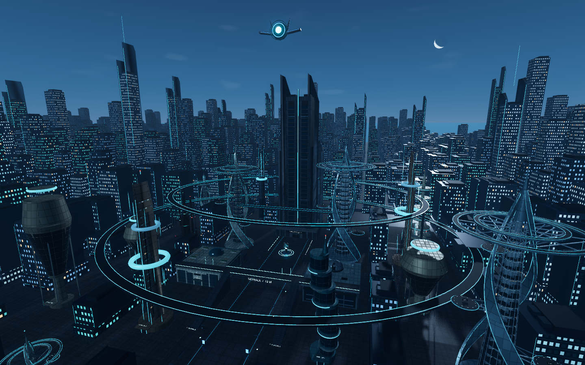
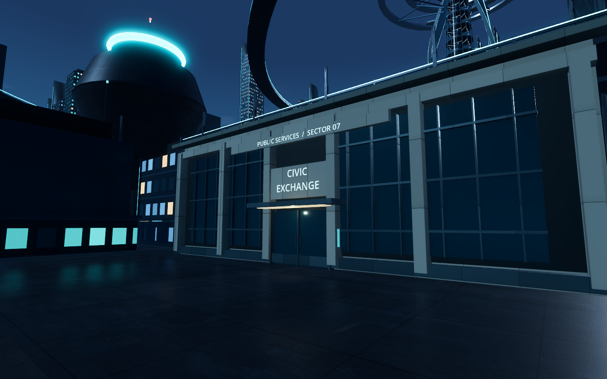
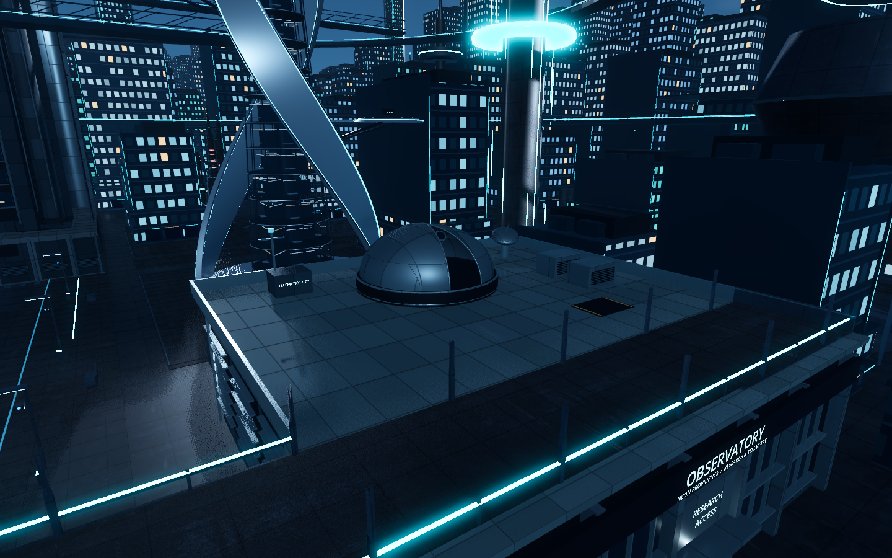
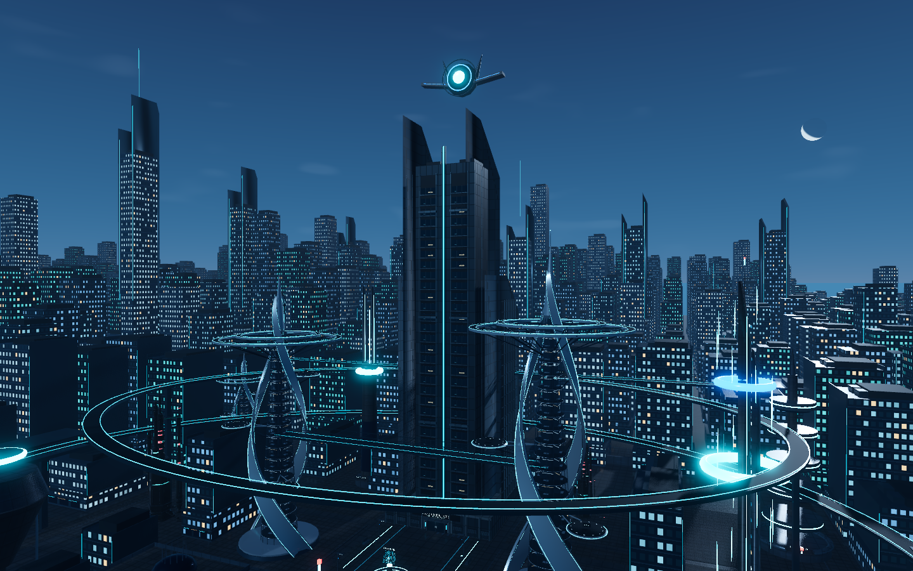

# Neon Providence

A persistent, explorable futuristic city built with Godot 4 and an authoritative Python simulation, connected over WebSockets and persisted with SQLite.

## Latest visual updates

The 18 nearby district towers now have distinct facade materials, glazing, structural framing and restrained lighting while preserving their characteristic silhouettes and collision footprints. [Tower review](docs/previews/nearby-towers/README.md).



The project, orbital satellite, and central headquarters are now **Neon Providence**. Existing save locations and historical media paths are retained. Launch with `Launch Neon Providence.command`; the former launcher remains compatible.

The Civic Exchange now has a stone-and-glass facade, a lit entrance, and a walkable rooftop terrace with seating, planting, shade, and a framed skylight. [Review notes](docs/previews/civic-exchange/README.md).



The Observatory now has a slotted instrument dome, visible telescope, telemetry dish, weather mast, service equipment, and a detailed technical facade. The dome and telescope rotate with the saved city day cycle. The skywalk and roof aisle remain accessible. [Day-cycle preview](docs/previews/observatory/rotation/day-cycle.mp4) · [Review notes](docs/previews/observatory/README.md).




[Watch the animated CITY UPLINK globe](docs/previews/uplink/city-uplink.mp4)



## Current stage

Stages 1–6 are implemented and verified within the [documented performance limits](docs/STAGE_6E.md). Saved populations support 34, 50 or 100 residents, including five police and four Exceptional Agents. Neon Providence provides inspection, evaluation, held destination commands, live scene feeds and retained audit history. See the [final MP4 review](docs/previews/stage6e/Brother-Eye-Stage-6E.mp4), [durable handoff](PROGRESS.md) and [staged build plan](docs/BUILD_PLAN.md). Fifty residents remain recommended for smoother performance.

Additional video: [24-hour lighting time-lapse](docs/previews/day-cycle/Brother-Eye-24-Hour-Cycle.mp4) — morning → sunset → night → next morning in about 60 seconds. This separate lighting study leaves gameplay time and saves untouched; the normal game retains its established blue-hour sky. See [recording notes](docs/DAY_CYCLE_REVIEW.md).

[Watch the complete city showcase](docs/previews/showcase/Brother-Eye-Complete-Showcase.mp4) — about 5 minutes 37 seconds covering city life, all four Exceptional Agent interactions, Neon Providence controls, and the separate lighting time-lapse. [Showcase notes and reproduction](docs/COMPLETE_SHOWCASE.md).

## Fresh checkout

Install Godot 4 and Python 3.12, then run from the repository root:

```sh
python3.12 -m venv .venv
.venv/bin/python -m pip install -r backend/requirements.txt
godot --headless --path godot --editor --quit
godot --path godot
```

Processed runtime models, their attribution, editable project assets, source code, tests, documentation and review evidence are included. Local saves, the virtual environment, Godot's generated cache, original source downloads and reference images are excluded. Launching a fresh checkout creates a new city; it does not include the original author's saved population state. Blender is only needed to rebuild editable assets, not to run the supplied processed models.

Double-click `Launch Neon Providence.command` to play, or open `godot/project.godot` in Godot and press F5. Choose **Enter streets** or **Free fly**. Escape releases the mouse; F1 shows controls; **F2 opens city time and saves**. Ctrl+Shift+B switches modes and can be rebound. Closing the window saves and stops the service; reopening restores your city without advancing time while closed.


The city uses a restrained blue-hour atmosphere with a pale crescent, faint horizon afterglow and soft lighting. Neon Providence remains the focal point. See [sky design notes](docs/SKY_DESIGN.md).

The reference document is a planning baseline. Later choices made in the conversation supersede it: infer architecture and street-level details from the supplied pictures; create a Neon Providence satellite with a matching command tower; use the supplied human for everyday citizens and astronaut for the four Exceptional Agents.

## Civilian appearance checkpoint

Stage 3A is ready for review: one enhanced civilian based on the supplied human, with clothing, materials, hair and ground-scale preparation. Double-click `Review Civilian.command` for the isolated viewer. This original appearance viewer remains static; separate rigged versions are now available in 3B below. See [Stage 3A review](docs/STAGE_3A.md).

## Character motion checkpoint

Stage 3B now provides one rigged civilian and one Exceptional Agent with idle, walk, run, sit-down, seated-idle and stand-up clips. Double-click `Review Animations.command` for the separate viewer. See [Stage 3B review and validation](docs/STAGE_3B.md). City navigation and persistent behavior are available below.

## City navigation checkpoint

Double-click `Review Navigation.command` to follow one civilian through the existing city. F4 switches walk/run, F5 introduces an obstruction, and F7–F10 select destinations. The civilian uses physical collision, routes around obstacles, and traverses both stairs and the skywalk. See [Stage 3C review and validation](docs/STAGE_3C.md).

## Persistent behavior checkpoint

Double-click `Review Population.command` (the existing `Review Behavior.command` also works). **[ / ]** selects the previous/next person, **F3** follows that person, **F4** toggles behavior details, and **F2** opens city time and saves. While following, use **WASD / E Q** to move the camera, **click-and-drag or two-finger scroll** to orbit, and **R** to reset. This uses the normal city save; the navigation and animation viewers remain separate review tools. See [Stage 3E population and validation](docs/STAGE_3E.md).

## Neon Providence inspection checkpoint

Double-click `Review Inspection.command`, or press **F5** in the normal city. Search by name, role or identity and filter civilians/police. Tabs show overview, known places, schedule, memory/decision history, assessment and interventions. **F3** follows the selected resident; **F2** opens city time; **Escape / F5** closes inspection. Browsing leaves resident state unchanged. The connection indicator identifies retained data when offline. See [Stage 4A review and validation](docs/STAGE_4A.md).

## Neon Providence evaluation checkpoint

Open `Review Evaluation.command` or press **F6** for the city assessment. **Inspect first finding** opens the highest-priority resident's Assessment tab; any resident can also be selected from the roster. Filter **Flagged residents** to review affected people. Findings explain the observed value, rule, recovery response and suggested next step. These are deterministic assessments; they do not issue interventions. See [Stage 4B evaluation and validation](docs/STAGE_4B.md).

## Neon Providence intervention checkpoint

Open `Review Interventions.command`, or use **F5 → select resident → Interventions**. Choose a known destination, enter a reason and issue the override. It takes priority over needs/schedule until **Release to autonomy**, even after arrival. Commands can be issued while paused; use **F2 → Resume** for travel. Pending/rejected/accepted results and physical travel/wait/completion are visible. See [Stage 4C authority and validation](docs/STAGE_4C.md). Satellite feedback and simulated camera feeds are available in Stage 4D below.

## Neon Providence control-room checkpoint

Open `Review Control Room.command` or press **F7**. Choose one of four real-scene camera views; feeds stop rendering when closed and freeze with retained-data labels offline. Browse retained committed intervention events or filter the selected resident, use **Older** for past pages and **Refresh** for new events. New accepted commands briefly brighten the lens/tower axis once; rejected and recorded replay results have distinct messages. See [Stage 4D presentation and validation](docs/STAGE_4D.md).

## Stage 4 acceptance checkpoint

Stage 4A–4E are verified for inspection, deterministic evaluation, explicit known-destination interventions, physical consequences, simulated cameras and committed audit history. The combined native/headless scenario includes blocked-route recovery and backend/app restoration. See [Stage 4E acceptance and limits](docs/STAGE_4E.md) and [durable handoff](PROGRESS.md). Stage 5A–5E are complete; Stage 6A/6B corrections are verified. See [Exceptional Agent behavior and authority](docs/STAGE_5A.md).

## Exceptional Agents

Open `Review Exceptional Agents.command`, or **F5 → Exceptional Agents**, to inspect the four named astronaut variants. **F3** follows the selection; **Interventions** can assign a known destination or release it. The Arbiter now observes local unmet needs, chooses fairly, walks beside a recipient and completes voluntary assistance after a confirmed five-second interaction. Overview shows evidence, actions, outcomes and learned trust. The Attendant verifies local information and develops useful contacts; the Martyr coordinates a persistent civic project with voluntary helpers; the Sovereign prioritizes their companion after urgent personal needs. Meetings leave space for helpers to depart. The city supports saved tiers of 34, 50 or 100 people; schema 8 preserves existing identities and overrides with bounded receipt history and safe retired retries. The normal city produces requests from actual local need; it does not inject demonstration recipients. See [Stage 5D behavior and verification](docs/STAGE_5D.md).

## Layout

- `godot/`: Godot application, scenes, scripts, and runtime-ready assets.
- `backend/`: Python world state, simulation, WebSocket service, persistence.
- `tools/`: reproducible setup, asset processing, and diagnostics.
- `assets/source/`: untouched local source downloads, excluded from Git.
- `references/`: supplied specification and reference images, excluded from Git.
- `docs/`: milestone decisions, setup notes, and asset provenance.
- `runtime/`: local saves and logs, excluded from Git.

Only processed assets needed by a milestone should enter the Godot project. Raw downloads and reference images stay outside its import tree.


Open **`Launch 50 Residents.command`** to upgrade the existing city to 50 residents once, preserving its original residents and ongoing work. The normal launcher keeps the saved tier. Current verification and benchmark limits: [Stage 6A/6B corrections](docs/PRE_6C_FIXES.md). For a disposable physical seating/stroll/budgeting check, run `.venv/bin/python tools/check_pre6c_fixes.py`; it does not use your saved city.


Stage 6C visual budgeting is verified: opaque spatial batches with mesh LODs, distant decoration cutoff and camera-aware character detail. See [Stage 6C results and limitations](docs/STAGE_6C.md). Run `.venv/bin/python tools/check_stage6c.py` for the controlled disposable 50-person comparison. Stage 6D retention is also verified: bounded event/full-receipt windows, safe retries after pruning, and a visible audit-retention notice. See [Stage 6D results and maintenance](docs/STAGE_6D.md). Reproduce with `.venv/bin/python tools/check_stage6d.py` (add `--native` for the rendered check); it uses disposable saves. Stage 6E is complete within measured limits. See [final acceptance and performance](docs/STAGE_6E.md) and [the 57-second MP4 review](docs/previews/stage6e/Brother-Eye-Stage-6E.mp4). **50 residents remain recommended for 60 FPS headroom**; 100 is an opt-in tier with slower skyline/control-room views. `Launch 100 Residents.command` durably expands the saved city; normal/smaller-tier launchers do not shrink it. Reproduce disposable native acceptance with `.venv/bin/python tools/check_stage6e.py`.
