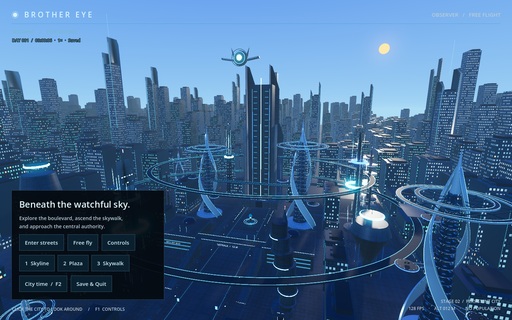

# Blue daylight sky and yellow sun

Historical visual checkpoint. The current atmosphere supersedes this version; see [sky design notes](SKY_DESIGN.md).

The environment now uses a clear blue gradient, a warm yellow sun with a restrained scattering halo, soft directional sunlight and a cool ambient fill. The sun appears in the open northeast sky, to the right of Brother Eye in the default skyline composition. The satellite retains its original geometry, location, orientation and motion. City geometry, building placement and transit rings are unchanged.

`godot/shaders/daylight_sky.gdshader` draws the gradient and sun at sky depth. The visible sun direction and `MorningSun` lighting share the same orientation. A 1.8-degree sun diameter keeps it legible without overpowering the satellite. The fill light contributes no additional sky disc. Reduced fog and bloom keep the satellite and distant silhouettes readable; reduced sunlight specular intensity softens reflected highlights.

This is a fixed morning daylight composition. The persistent clock continues to work; sunrise/sunset and a full day/night cycle are not part of this visual change.

Validation: native Metal / Forward+ captures at 1440×900 were reviewed at skyline, plaza and skywalk viewpoints, with the real clock service enabled against an isolated temporary save. No shader/runtime errors occurred. A source comparison confirmed that `city.gd` changes are confined to `build_environment()`; its layout and satellite functions are byte-for-byte unchanged. The HUD clock has a dark text outline for contrast against the brighter sky.

The 240-frame capture measured 8.187 ms median and 9.214 ms p95 frame intervals on the M2 Pro. This is a rendering sample, not a long-running population benchmark. Previews and the raw report are in `docs/previews/daylight/`.

