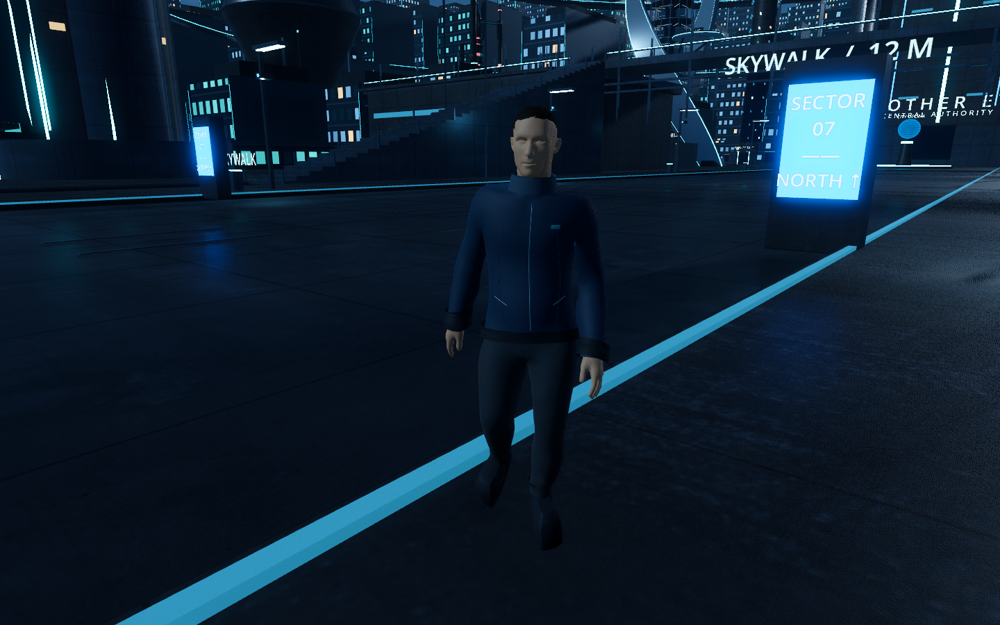

# Civilian curb and obstacle recovery

The Sector 07 report was reproduced from the existing save's position `(12.21047, -0.09978, 82.59981)`, travelling home to `(18, 0.12, 90)`. The old controller remained at that position. Its one-frame horizontal collision probe missed the rounded-foot curb contact; lifting the capsule alone also let the rounded base slide back down the edge.

The civilian now uses the existing rounded torso clearance plus a small flat foot support, retaining the same overall body height. Supported steps up to 25 cm use a forward obstruction probe, obstacle-top and landing rays, and upward/forward body sweeps. Low steps require clear headroom and footing beyond the edge. Walkable ramps use normal floor motion rather than curb assistance. Movement is physical; the save position and city layout are not reset or edited.

Navigation now uses 5 cm height sampling and the same 25 cm climb limit as the body, so a larger obstruction is carved out of the route rather than treated as a step. Two seconds without 15 cm of net horizontal progress triggers `WAITING FOR ROUTE` and route rebuilding. Rebuilds have an eight-second cooldown and waiting retries occur every five seconds. An unavailable route stays idle; the behavior panel explicitly displays **BLOCKED · WAITING FOR ROUTE**. Time and needs continue according to the existing city clock while an agent waits.

## Verified

- Fourteen focused checks pass: the exact saved curb position reaches home, walking/running cross a thin 20 cm strip, steps reject inadequate headroom and missing landing support, a 35 cm obstruction and a large barrier are detoured around, and blocked/unreachable travel reports waiting and idles.
- All 26 city navigation checks pass across the promenade, both stair ramps, terrace, skywalk, street crossing, unexpected barrier and running recovery. The updated mesh has 2,185 polygons; the east stair approach covers about 49.9 m without the unstable foot contact found during implementation.
- Stride checks retain 1.15 m/s walking and 2.4 m/s running. Mean stance ankle drift remains about 0.286 / 0.155 m/s respectively; this is not new foot IK or a dedicated step-over animation.
- Four real app launches pass persistent routine, pause, arrival, save/restore, reconnect and interrupted movement replay checks. The user's real save was read for reproduction and left untouched by validation.
- Native Metal / Forward+ screenshots show the civilian crossing the reported curb. No city geometry or model appearance changes were needed.



Reproduce:

```sh
godot --headless --path godot --fixed-fps 60 --script res://scripts/check_obstacles.gd -- --no-simulation
godot --headless --path godot --fixed-fps 60 --script res://scripts/check_navigation.gd -- --navigation-review --no-simulation
godot --headless --path godot --fixed-fps 60 --script res://scripts/check_stride.gd
.venv/bin/python tools/check_stage3d.py
```

[Obstacle checks](previews/obstacle-fix/checks.txt) · [Navigation checks](previews/obstacle-fix/navigation.txt) · [Save/restart checks](previews/obstacle-fix/persistence.txt)
