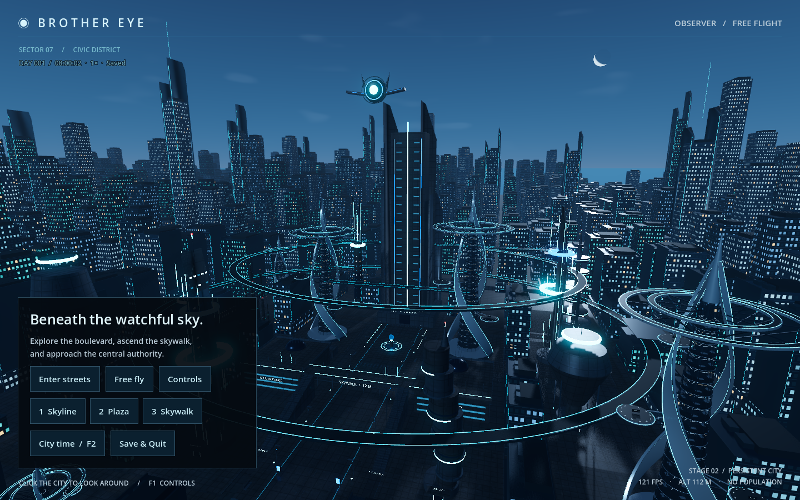

# City atmosphere refinement

The original navy, steel-blue and cyan concept favors an atmospheric sky that supports Brother Eye's surveillance presence. The new treatment uses a blue-hour gradient, subtle low-horizon afterglow, sparse cirrus wisps and a single pale crescent. The visible sun disc is omitted: pairing two bright celestial objects would compete with the eye and the skyline.

The crescent is small (about 1.8 degrees across), softly shaded, lightly textured and placed in the northeast sky. In the default skyline composition it appears in open space to the right of the northwest satellite, without overlap. The satellite's cyan lens remains brighter and more prominent. The moon is a sky element, so it cannot obstruct foreground geometry.

Soft cool lighting preserves metallic highlights, readable streets and the cyan architecture. Fog and bloom stay restrained. The sky has no dense star field or luminous decorative effects. This is a fixed art-directed atmosphere; the persisted simulation clock is unchanged, and no day/night cycle is implied.

Implementation: `godot/shaders/city_sky.gdshader` replaces the daylight shader; `build_environment()` in `godot/scripts/city.gd` sets its moon direction and the twilight lighting. A source comparison confirmed all code outside that function is identical to the previous version. City layout, transit rings, satellite geometry/transform/motion, controller and persistence code are unchanged.

Validation: native Metal / Forward+ rendering with the real clock service enabled against a temporary save, at 1440×900. Skyline, plaza and skywalk captures were visually reviewed; no shader or runtime errors occurred. The 240-frame skyline sample measured 8.248 ms median and 9.076 ms p95 frame intervals on the M2 Pro. Previews and the raw report are in `docs/previews/atmosphere/`.

