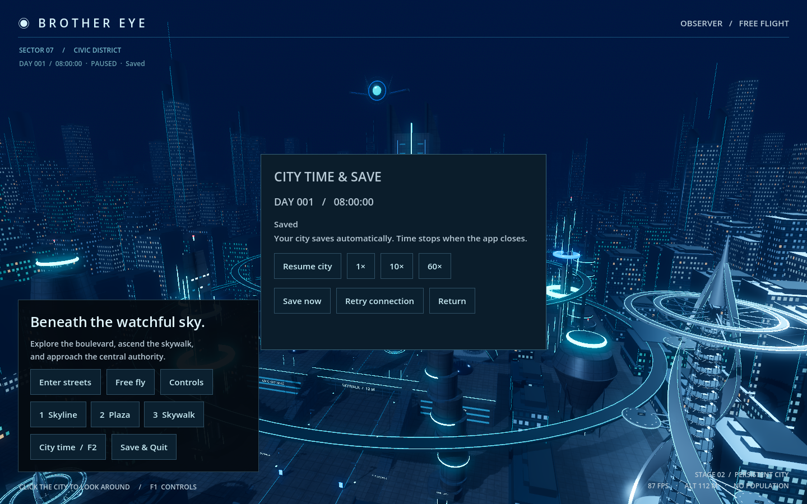

# Stage 2 — Persistent application and simulation foundation

Stage 2 adds an authoritative local Python service to the existing Godot city. The service owns one durable world identity, clock, clock settings and explorer state. The accepted city geometry and elliptical transit rings are retained.

## Use

Double-click `Launch Brother Eye.command`, or run the project in Godot with F5. Python starts automatically with the app. Press **F2** or choose **City time** to pause/resume, select **1× / 10× / 60×**, or save. Close the window or choose **Save & Quit** to commit the current view and stop the service. Reopening restores the ground location/look direction, observer location/look direction, active camera mode, flight speed, clock and time controls.

The world starts at day 1, 08:00. Time advances only while an authenticated app client is connected and responsive. It does not advance while the application is closed. The clock does not drive lighting. Stage 3D now uses it for civilian needs and routines; see [the current behavior checkpoint](STAGE_3D.md).



## Local files and setup

- `runtime/world.sqlite3`: world checkpoint, event history and durable command receipts.
- SQLite may create `world.sqlite3-wal` and `world.sqlite3-shm` while open. Close the app before copying a save, or use SQLite's backup API; copying only the main file during a session can omit recent transactions.
- `runtime/world.sqlite3.pending.json`: frontend journal of requests awaiting acknowledgement. Keep this with the save when recovering interrupted edits.
- `runtime/service.log`: service start/stop, connection and failure logs, rotated at 1 MB with three backups.
- `runtime/world.sqlite3.lock`: advisory lock, released automatically on service exit. Its file remaining on disk does not mean a service is running.
- `runtime/session-<id>.json`: temporary rendezvous containing the local service port/PID, removed on orderly service exit. A force-killed service can leave an inert rendezvous file; a new launch uses a new ID.

The existing Python 3.12 project environment is used. The only new package is pinned in `backend/requirements.txt`:

```sh
.venv/bin/python -m pip install -r backend/requirements.txt
```

The app never installs dependencies on launch. Missing tools/dependencies and unreadable saves produce an error; the app does not silently replace an existing world. The renderer remains Godot Forward+ on native Metal.

## Authority and persistence

`backend/store.py` originally created SQLite schema version 1; Stage 3D upgrades it to version 2 through an explicit migration transaction (`PRAGMA user_version`). The `world`, `events` and `receipts` tables separate current state, diagnostics and request deduplication. SQLite WAL plus `synchronous=FULL` protect committed transactions. A command's world change, receipt and event share one transaction; the server sends its acknowledgement only after commit. Repeating an identical request UUID returns its original acknowledgement. Reusing that UUID with different data is rejected.

The frontend journals requests before transmission and removes them after acknowledgement. It retries the same UUID after connection loss and replays pending requests on a later launch. Unsent camera updates can coalesce; a request already sent is never changed under its UUID. The journal records its world ID and refuses to apply to a different world. Invalid journals, saves from a newer schema and corrupt databases are preserved for diagnosis.

The service advances time at approximately 20 Hz using monotonic elapsed time and publishes snapshots at 4 Hz. Explorer updates are captured about once a second; idle clock checkpoints occur every two seconds. Explicit saves and clock/view commands commit immediately. A crash can lose elapsed clock time since the last checkpoint (normally at most two seconds) and movement since the last view capture (normally at most one second). Already journaled requests are recovered. Large scheduler gaps, including computer sleep, are not added to simulation time.

## Process lifecycle and connection

Godot starts one child Python process on an ephemeral loopback port with a fresh random session token. Only one authenticated app client is accepted per service. An OS advisory lock prevents a second service from opening the same world. A second application window displays the lock error; it can retry after the first closes.

Window close drains pending requests, sends a final view and shutdown command, then exits after acknowledgement. If the connection is unavailable, the frontend retains its pending journal and exits after a six-second grace period, provided the journal can be written. The service monitors the owning Godot PID and stops when it exits. It also stops after 12 seconds without client activity; the clock freezes after three seconds without heartbeats. There is no installed daemon or scheduled background job.

Socket loss reconnects to the existing service. Unexpected child-process death triggers up to three automatic restarts, retaining the same saved world and queued requests. **Retry connection** permits another attempt after the underlying startup/lock problem is resolved. Input is suspended during restoration and connection loss so the app cannot overwrite a saved view with its initial camera.

Protocol version 1 uses text JSON envelopes:

```json
{"v":1,"type":"set_clock","id":"<request UUID>","payload":{"paused":true,"time_scale":10}}
```

Client messages: `hello` (session token), `heartbeat`, `set_clock`, `set_explorer`, `set_citizen_progress` (added in 3D), `save`, `shutdown`. Server messages: `welcome`, `snapshot`, `ack`, `error`. Mutations require UUIDs. Unknown versions, malformed envelopes, non-finite numbers and invalid state values are rejected. Messages are limited to 16 KB. Browser origins are rejected; the interface is intended for this local app. This is a local development service, not a remote multiplayer protocol.

## Verified checkpoint

Validation uses temporary saves and leaves the real `runtime/` world untouched.

```sh
.venv/bin/python -m unittest discover -s backend/tests -v
.venv/bin/python tools/check_stage2.py
godot --headless --path godot -- --qa
```

- Ten backend tests exercise state/receipt atomicity (including an injected transaction failure), deduplication, validation, migration/restore, save locking, future/corrupt save preservation, real WebSocket reconnect/restart, backend crash replay and owner-exit shutdown.
- Five actual Godot launches verify both camera modes, position/look/flight speed, pause/speed restoration, zero offline clock advancement, reconnect without a second world/service, queued edits after backend failure, pending journal replay after abrupt frontend exit, service shutdown and SQLite integrity.
- The recovered crash command has exactly one durable receipt, and only one world creation event exists across all five launches.
- All 13 existing controller/collision checks pass, including the facade, stairs, skywalk, railing and rebound mode key.
- The time-and-save panel was rendered and visually inspected at 1440×900 using native Metal / Forward+ on the M2 Pro.

At the original Stage 2 checkpoint, population, animation, navigation, needs and routines were unimplemented. Stages 3A–3D now add those foundations for one civilian; see [Stage 3D](STAGE_3D.md). Brother Eye interventions remain a later stage. The current event/receipt history grows with use; retention and compaction will be needed before long-running population sessions.
