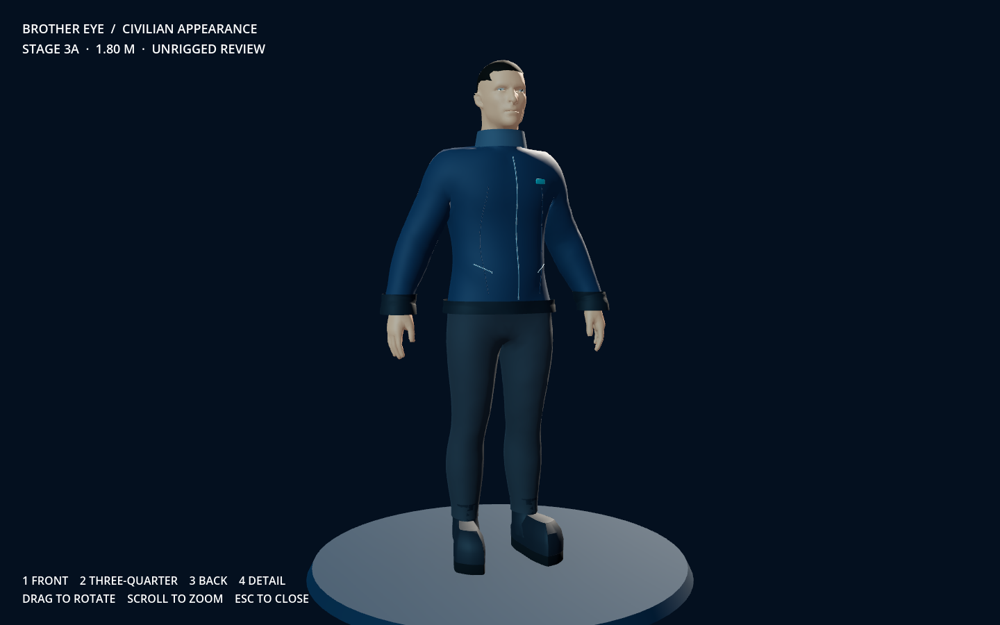
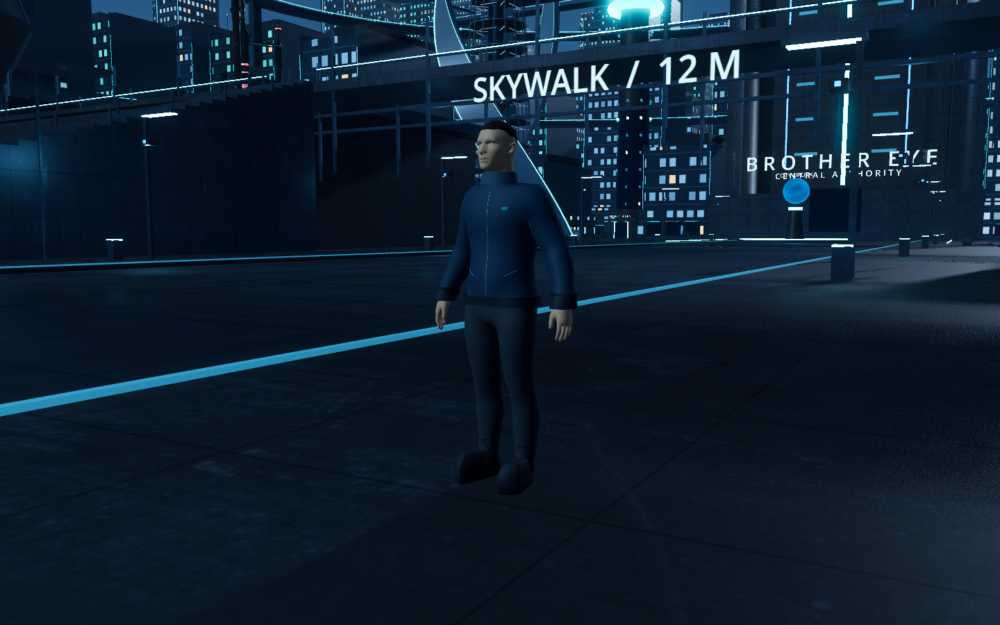

# Stage 3A — Civilian appearance

One supplied human is now prepared as a static civilian appearance for visual review. The appearance checkpoint is complete; rigging, skin weights, animation, navigation and population behavior have not started.

## Delivered appearance

The design uses a midnight-navy technical jacket with a stand collar, restrained seams and brushed zipper/pocket details, a small muted-teal civic ID tab, graphite trousers, and practical dark shoes with continuous uppers and rubber soles. Natural skin and cropped dark hair keep the person visually distinct from the armored Exceptional Agents. No emissive body stripes or police markings are included.

The source's body proportions and relaxed A-pose are retained. The asset is about **1.795 m tall**, with its feet at the ground origin. It has **13,357 triangles**, 25 mesh parts, no skeleton and no animation clips. The GLB is 284,208 bytes, uses embedded geometry and material colors, and has no external image dependencies. The face is stylized and has basic surface eye details; this is a city resident asset rather than a photoreal facial character. Facial animation and deformation quality are not verified here.

## Review

- Reviewed Blender front, three-quarter, back and face/collar close-ups; corrected source transforms, garment boundaries, neckline coverage, shoe uppers and eye placement during iteration.
- Imported and rendered the exported GLB with native Godot Metal / Forward+ at 1440×900, using front, three-quarter, back and detail studio views.
- Rendered a temporary civilian placement in the existing city to review human scale and palette under its actual atmosphere. This placement exists only in the capture script: the playable city, satellite and persistent save are unchanged.
- Verified the original source SHA-256 remains identical to the inventory; checked GLB version/header, finite geometry bounds, triangle count and absence of skeletons, clips or external image dependencies.
- No Godot import, script or runtime errors occurred in the final review capture.

My visual assessment: the civilian reads as an ordinary resident and fits the city's blue/charcoal palette without competing with the cyan architecture. The small teal detail provides continuity with the setting. The supplied mesh's facial detail remains stylized; it is suitable for reviewing a city population direction, not a claim of cinematic close-up quality. Motion and garment deformation must receive a separate review in 3B. Mesh/material consolidation and detail levels remain work before scaling a crowd.

## Open the review

Double-click **Review Civilian.command**. It opens a separate viewer with no backend or save changes. Use **1–4** for front, three-quarter, back and detail; drag to rotate and scroll to zoom. Escape closes it. The main Brother Eye launcher still opens the city.

Files:

- `godot/models/civilian/civilian.glb`: Godot-ready static appearance.
- `assets/working/civilian/civilian_appearance.blend`: editable source with character, materials and review studio.
- `godot/scenes/civilian_review.tscn`: isolated interactive viewer.
- `tools/build_civilian.py`: reproducible Blender build/export/render script.
- `godot/scripts/civilian_capture.gd`: native studio and temporary city-context captures.
- `godot/models/civilian/appearance_report.json`: geometry and material inventory.
- `godot/models/civilian/ATTRIBUTION.md`: original author/license and modifications.

Rebuild and capture:

```sh
blender --background --python tools/build_civilian.py
godot --headless --path godot --editor --quit
godot --path godot --script res://scripts/civilian_capture.gd
```

The supplied Human model is by **aaron.kalvin**, licensed CC-BY-4.0. Its original file and metadata are preserved. No supplied animation has been incorporated yet, including the noncommercial run.




