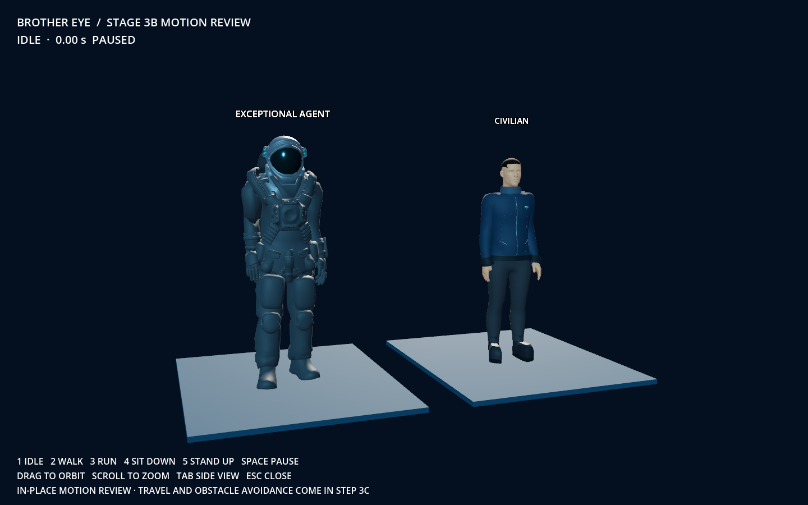

# Stage 3B — Rigging and animation proof

One civilian and one supplied astronaut now have working biped rigs and baked skeletal clips. This is the second Stage 3 checkpoint. The playable city still has no autonomous population; navigation, persistence and crowd expansion remain 3C, 3D and 3E.

## Review the result

Double-click **Review Animations.command**. Both characters appear in an isolated studio. The city, satellite, backend and save are unchanged. The original static 3A review remains available through **Review Civilian.command**.

- **1** idle, **2** walk, **3** run, **4** sit down, **5** stand up.
- **Space** pauses; drag orbits; scroll zooms; **Tab** switches the camera to a side view; **Escape** closes.
- Sit down completes into seated idle. A walk/run request while seated first plays stand up, then starts the requested motion.
- The seats are contact references for the two different body sizes, not city furniture.

[Motion preview video](previews/stage3b/motion-review.mp4)



## Delivered

The civilian retains the Stage 3A appearance and approximately 1.795 m height. The astronaut retains the supplied geometry at approximately 1.95 m, with graphite/slate armor and a smoked teal visor. Each has 19 deforming biped bones; glTF includes an additional root joint. The rig supports body movement, not finger gestures or facial expressions. Both editable Blender files and separate runtime GLBs are included.

| Clip | Duration | Source |
| --- | --- | --- |
| idle | 3.20 s | Authored breathing/head/arm motion |
| walk | 2.80 s | Supplied jlwande2 walk, transferred and corrected |
| run | 0.80 s | Authored two-link leg solve and arm swing |
| sit_down | 1.93 s | Reversed transferred sit-to-stand segment |
| sit_idle | 3.20 s | Transferred seated pose with subtle breathing |
| stand_up | 1.93 s | Supplied abysmaljess motion, transferred and corrected |

The transfer samples evaluated world joint directions instead of copying incompatible local Euler tracks. Facing and left/right mapping are corrected. Joint landmarks account for the astronaut's raised left arm and both source meshes' asymmetric rest poses. Skin weights blend across flexible regions; disconnected armor plates receive rigid joint bindings. The long glove cuffs blend between forearm and hand so they remain attached through wrist bends. Seated motion uses a two-link leg solve with independent planted ankles and level soles through sitting and standing; other clips receive a baked floor adjustment. Running stance feet move backward relative to the body, with forward recovery during swing. All motion is in place, with vertical pelvis movement and the small displacement required to sit. AnimationPlayer blends locomotion changes over 0.18 seconds.

The noncommercial supplied run is not included. Geometry and transferred walk/sit motion retain their original CC BY attribution; see `godot/models/animated/ATTRIBUTION.md`.

## Validation and review

- Imported and rendered the final GLBs in native Godot Metal / Forward+ at 1440×900. Reviewed idle, walk, run, mid-transition and seated poses, including side views; recorded the sequence as a review video.
- Godot automated checks pass for both skeletons, all six nonempty clips, finite interpolated poses, loop closure within 2.5 cm, completed sit/stand transitions, queued locomotion and pause behavior.
- Independently re-imported exported GLBs into Blender. Every exported mesh has a skin, weights are normalized, sampled deformed bounds remain finite and bounded, and floor contact is checked at 49 times per clip, including between authored keyframes. Additional regressions check both seated soles within 12 mm of the floor, foot orientation against the flat rest pose, horizontal contact drift below 4 mm, and backward stance-foot motion for forward running. Measurements are in `godot/models/animated/export_qa.json`.
- Original source files and static 3A assets are preserved. No city/backend scripts or persistent world data were changed.

This is a functional animation proof with stylized characters, not finished cinematic character animation. Deep bends still compress the jacket and under-suit, and some short edges stretch; the QA report records this rather than treating bounded geometry as perfect deformation. Close-up weight painting, corrective shapes, hand gestures, facial motion, cloth simulation and crowd detail levels remain polish work. Small contact drift remains in interpolated transitions. In-place playback cannot establish foot sliding against actual travel: stride speed and turning must be matched and reviewed with navigation in 3C.

## Files and reproduction

- `godot/models/animated/civilian.glb` and `exceptional_agent.glb`: runtime rigs and clips.
- `assets/working/animated/civilian.blend` and `exceptional_agent.blend`: editable authoring files.
- `tools/build_animated_characters.py`: source sampling, rigging, skinning, animation baking and export. Extracts needed original ZIPs into an ignored working cache when needed.
- `godot/scenes/animation_review.tscn` and `godot/scripts/animation_review.gd`: separate interactive review.
- `godot/scripts/check_animation_review.gd`: playback/transition regression checks.
- `tools/qa/check_animated_characters.py`: validation of exported geometry and floor contact.
- `godot/models/animated/rig_report.json`: durations, authoring floor measurements and foot paths.

```sh
blender --background --python-exit-code 1 --python tools/build_animated_characters.py
godot --headless --path godot --editor --quit
godot --headless --path godot --script res://scripts/check_animation_review.gd
blender --background --python-exit-code 1 --python tools/qa/check_animated_characters.py
godot --path godot --script res://scripts/animation_capture.gd
```

For a native movie: run `animation_capture.gd` with `--write-movie /tmp/brother-eye-3b-final.avi --fixed-fps 24 --disable-vsync -- --movie`, then encode the AVI to MP4. The normal application launcher continues to open the existing city.

## October 12 animation corrections

Fixed the toe-down seated feet on both characters, the Exceptional Agent's long glove cuff attachment, and the reversed run swing/stance phase. Rebuilt both GLBs and editable rigs, reviewed separate close-up renders, and regenerated the motion preview. The Godot playback suite passes 6,037 checks; independent exported-GLB checks pass for both characters across six clips at 49 samples per clip.

Follow-up: replaced the civilian waist-level seated arm pose with a two-link lap pose, palms facing down, blended through sit/stand. Civilian cuffs follow the forearms without palm-driven twisting. Export QA now checks that seated hands clear the torso, remain over the lap, and point forward. Re-rendered the stills and motion preview; both exported-GLB and Godot checks pass.

Stage 3C follow-up: running stance now has constant backward foot speed (1.65 m/s at original cadence), with forward recovery during swing, to match actual travel. The seated hand, glove and sole corrections are retained.
