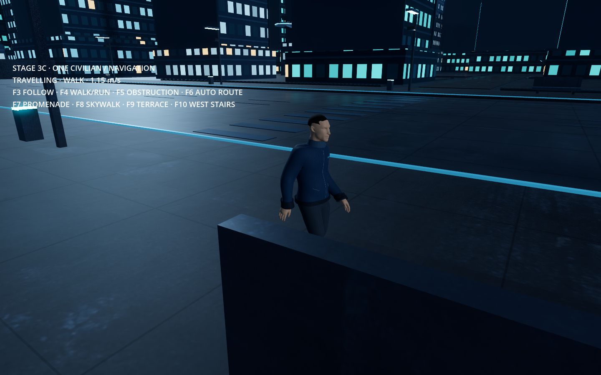

# Stage 3C — One civilian navigating the city

Step 3C provides a reviewable navigation checkpoint in the existing city. One animated civilian follows a pedestrian circuit through the promenade, east stairs, skywalk, rooftop terrace, west stairs and a street crossing. Open **Review Navigation.command**. The viewer starts beside the civilian and requires no backend service.

## Controls

| Key | Action |
| --- | --- |
| F3 | Switch between following the civilian and the existing city explorer |
| F4 | Switch walking/running |
| F5 | Add/remove an amber obstruction on the east promenade |
| F6 | Toggle the automatic circuit; the current trip finishes |
| F7 | Send the civilian to the east promenade |
| F8 | Send the civilian to the skywalk |
| F9 | Send the civilian to the east rooftop terrace |
| F10 | Send the civilian to the west stair landing |
| Escape | Release the mouse in explorer mode |

Manual destinations suspend the automatic circuit. The original city controls remain available after F3 switches to the explorer. Close the review window when finished.

## Implementation

A bounded navigation mesh is baked from the actual static collision geometry over the central 140 × 175 m district, including the continuous physical ramps beneath the visible stair treads. The baker reserves 0.5 m of wall clearance and 1.9 m of headroom. One CharacterBody3D uses rounded torso clearance, flat foot support, gravity, floor snapping and supported curb stepping up to 25 cm. See [the obstacle correction](OBSTACLE_FIX.md). Navigation paths steer the body; collision remains authoritative. A turn rate limit and reduced forward speed during sharp turns prevent instant orientation changes.

The inner rooftop railings previously continued across the skywalk connection. Their final eight metres now form an entrance from the bridge onto each terrace. Other buildings and transit rings retain their layout.

When a physical obstruction stops progress, the civilian waits, requests a new asynchronous collision bake and resumes on the updated path. Explicit obstruction changes also request a bake. Destinations inside walls or beyond the supported surface are rejected; the civilian waits for a usable route or a new command. Navigation readiness waits for the server's map revision before releasing movement.

Walk speed is 1.15 m/s; run speed is 2.4 m/s. Animation cadence follows measured horizontal displacement, including slowing at turns or obstacles. The walk clip's measured stance speed is approximately 0.739 m/s at its original cadence. The authored run now uses constant backward foot movement during stance at 1.65 m/s at its original cadence, with forward recovery during swing. This corrects sliding that became apparent when the in-place animation was used for real travel.

The implementation uses Godot's [navigation mesh baking APIs](https://docs.godotengine.org/en/stable/tutorials/navigation/navigation_using_navigationmeshes.html).

## Verified checkpoint

- All 26 navigation checks pass, including eight physical trips: promenade, east stair ascent, terrace entrance, skywalk crossing, west stair descent, street crossing, unexpected obstruction detour and running recovery.
- A newly introduced collider triggers automatic rebuilding and a physical detour. An unreachable building destination produces a waiting state, and a subsequent valid destination recovers normally.
- The review entry point starts with its follow camera and navigation controls. Turning remains bounded to 2.8 radians/s.
- The final central navigation mesh contains 2,185 polygons after the obstacle correction. Observed headless bake times are recorded in the QA report; these are local measurements rather than a performance guarantee.
- Straight-line measurements verify the commanded walk/run speeds and measure stance ankle movement. The remaining mean horizontal ankle drift is about 0.29 m/s while walking and 0.15 m/s while running. These are skeleton ankle proxies, not measurements of the entire shoe sole.
- The original 13 player controller/collision checks still pass. The 6,037 animation playback checks and independent exported-character geometry/contact checks also pass after the run adjustment.
- Native Godot Metal / Forward+ renders were reviewed at 1440 × 900. The short preview is a montage of actual movement at selected locations; the capture script places the civilian between shots. Automated trip tests traverse the full routes without teleporting.

[Navigation preview](previews/stage3c/navigation-review.mp4) · [Navigation QA](previews/stage3c/navigation_qa.json) · [Stride measurements](previews/stage3c/stride_qa.json)



## Scope and remaining polish

This checkpoint uses one transient civilian in a separate city review mode. Durable identities, schedules, needs and saved destinations belong to 3D; the larger population belongs to 3E. Routes cover the central test district rather than every skyline building. Static obstacles are routed around through rebaking; moving-crowd avoidance is not yet implemented. Individual feet do not adapt to stair treads or uneven surfaces with runtime IK, and some foot drift and deep-bend deformation remain. The run stance correction also updates the shared Exceptional Agent animation export.

## Reproduce

```sh
godot --headless --path godot --fixed-fps 60 --script res://scripts/check_navigation.gd -- --navigation-review --no-simulation
godot --headless --path godot --fixed-fps 60 --script res://scripts/check_stride.gd
godot --headless --path godot --fixed-fps 60 -- --qa --no-simulation
godot --path godot --script res://scripts/navigation_capture.gd --write-movie /tmp/brother-eye-3c.avi --fixed-fps 30 --disable-vsync --quit-after 900
```

Runtime code: `pedestrian.gd` controls movement and animation; `pedestrian_navigation.gd` owns the bake, route commands and review controls. Navigation is enabled by the `--navigation-review` argument in `city.gd`. The normal Stage 2 launcher and persistent save format are retained.
