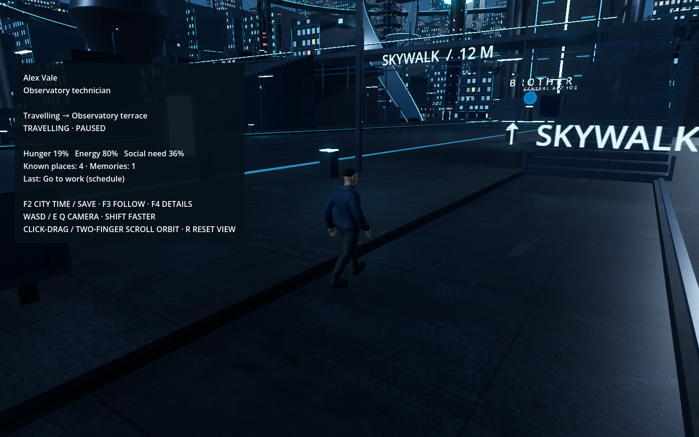

# Stage 3D — Persistent behavior

One civilian now lives in the normal city with a durable identity, needs, a daily schedule, four known destinations and bounded memory. The existing city, satellite, character model and animations are retained. This is the behavior checkpoint before expanding the population in 3E.

## Review

Double-click `Review Behavior.command` to open the same persistent city while following Alex Vale, an observatory technician. The normal `Launch Brother Eye.command` also includes Alex. Both use the existing `runtime/world.sqlite3`; open one at a time.

- **F3:** follow the civilian or return to the explorer camera.
- **F4:** show/hide identity, activity, destination, needs and latest memory.
- While following: **WASD** moves the camera, **E/Q** raises/lowers it, **Shift** moves faster, **click-and-drag or two-finger scroll** to orbit, and **R** resets the view. The camera retains your offset as the civilian moves; explorer position is preserved. Camera movement also works while city time is paused.
- **F2:** pause/resume, choose 1× / 10× / 60×, save, or Save & Quit.

Close and reopen to review restoration. Paused saves reopen paused; resume in F2. Needs and schedules use city time, while physical walking retains its measured 1.15 m/s pace at every time scale. At 60×, schedule changes can therefore occur during a journey. The civilian replans from their current position instead of teleporting.



## Behavior

Alex knows only four exterior access points in the existing navigable district: the residential promenade, observatory terrace, market promenade and uplink plaza. The daily schedule selects work at 08:00, lunch at 12:00, work at 13:00, the plaza at 17:00 and home at 19:00. It repeats daily using the Stage 2 clock, which starts at 08:00.

Hunger and social need increase, while energy decreases. Urgent needs can select a familiar destination instead of the scheduled one. Recovery continues to a lower threshold to prevent constant destination switching. Needs recover only after Godot reports physical arrival: eating lowers hunger, resting restores energy and time at the plaza lowers social need. These activities are simulation states with an idle animation at their exterior destination; interiors, eating gestures, sleep animations and actual conversations are not implemented here.

The last 16 decisions, arrivals and blocked-route observations are saved. The planner reads the citizen's own needs, schedule and known places. It has no Brother Eye access or knowledge of unknown destinations. Broader learning, relationships and conversational reasoning remain future work.

## Ownership and saves

`backend/citizens.py` owns identity, needs, planning and memory. `persistent_population.gd` restores the civilian, requests collision-backed travel and reports position, heading, navigation state, goal ID and a monotonic movement sequence. The backend confirms arrival within 0.95 m of the assigned destination. Stale goal reports and old movement sequences cannot overwrite a newer routine. The civilian freezes during pause, connection loss, restoration and route baking.

Save & Quit captures final movement before shutdown. Reports are journaled before sending and acknowledged only after the world, event and command receipt commit atomically. Ordinary movement capture is roughly once a second; clock/needs checkpoints are every two seconds. A sudden crash can lose uncaptured movement or uncheckpointed time within those intervals. Already journaled commands replay after recovery.

SQLite schema version 2 adds the civilian to existing world state through a transaction. Version 1 saves retain their world identity, clock, explorer, settings and receipts; migration seeds Alex once and records `citizens_migrated`. No offline time is added. Protocol version 1 adds `set_citizen_progress` to the existing commands. No additional dependencies or tools are required.

## Verification

Checks use isolated temporary saves and leave the user's `runtime/` save untouched.

```sh
.venv/bin/python -m unittest discover -s backend/tests -v
.venv/bin/python tools/check_stage3d.py
.venv/bin/python tools/check_stage2.py
```

The 18 backend tests cover schedules, stable identity, need recovery after arrival, bounded memory, invalid/stale movement, duplicate receipts, journal number compatibility, rollback, migration and restoration, alongside the Stage 2 persistence and service tests. Four actual Godot launches exercise pause, physical market arrival, hunger recovery, return to work, saved position/heading/needs/knowledge/memory, reconnect, service crash replay and abrupt frontend interruption. Crash replay has exactly one durable receipt; the same single citizen and world survive all launches, and SQLite integrity is checked. The five-launch Stage 2 acceptance check remains passing.

The behavior panel and civilian were rendered and visually inspected at 1440 × 900 with native Metal / Forward+ on the M2 Pro. Stage 3C's separate navigation review remains available; individual foot IK, crowd avoidance, additional people and population performance measurements belong to subsequent work. Event/receipt history still grows with use and will need retention before long-running larger populations.

All 13 original player/controller checks also pass. Saved evidence: [app acceptance](previews/stage3d/acceptance.txt), [backend tests](previews/stage3d/backend-tests.txt), [Stage 2 regression](previews/stage3d/stage2-regression.txt).

Follow-camera update: 19 checks verify all six movement directions, mouse orbit/release, touchpad click-drag and two-finger pan, fixed orbit distance and target centering, target tracking with a custom view, reset position/look, preserved explorer/civilian state and switching out/back. Reproduce with `godot --headless --path godot --script res://scripts/check_follow_camera.gd -- --navigation-review --no-simulation`.

The [civilian obstacle correction](OBSTACLE_FIX.md) reproduces and fixes the Sector 07 saved curb blockage, adds supported 25 cm stepping and larger-obstacle detours, and displays a clear blocked/waiting state. Existing saves recover without resetting identity or needs.
