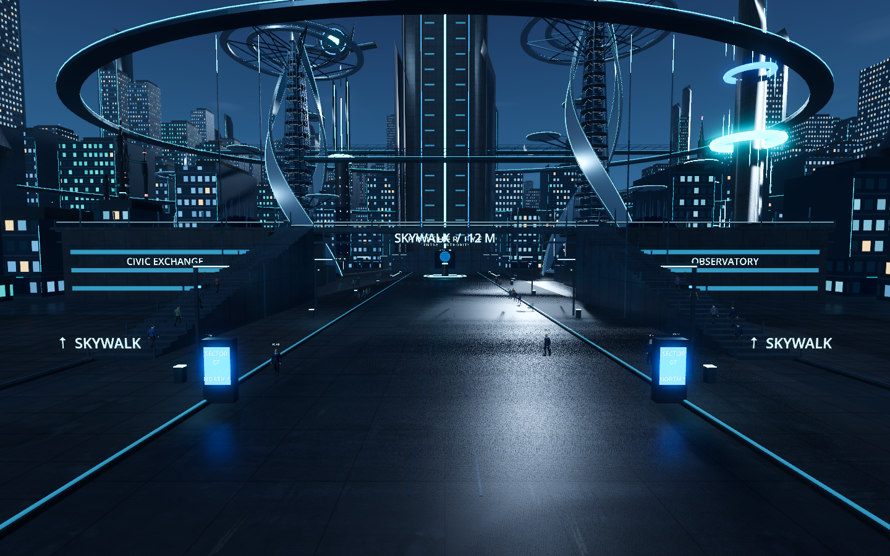
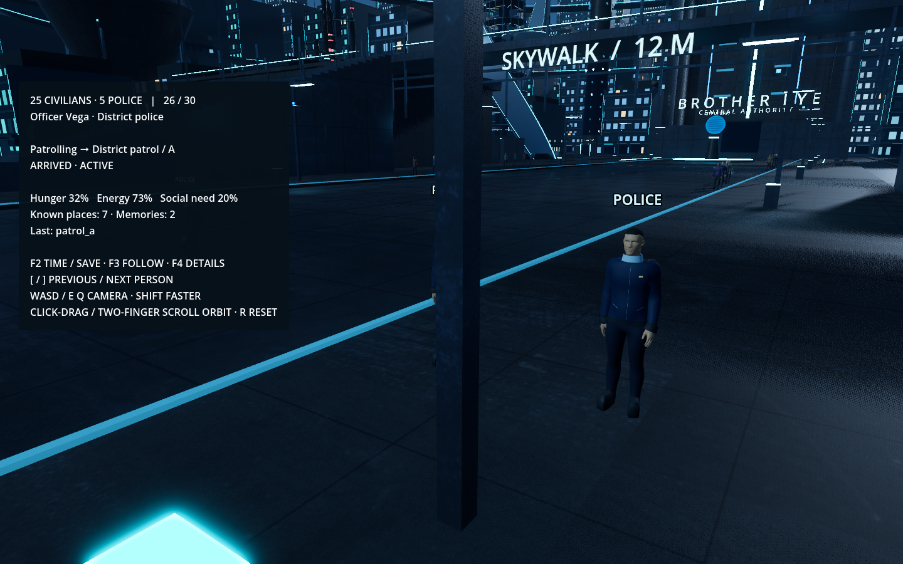
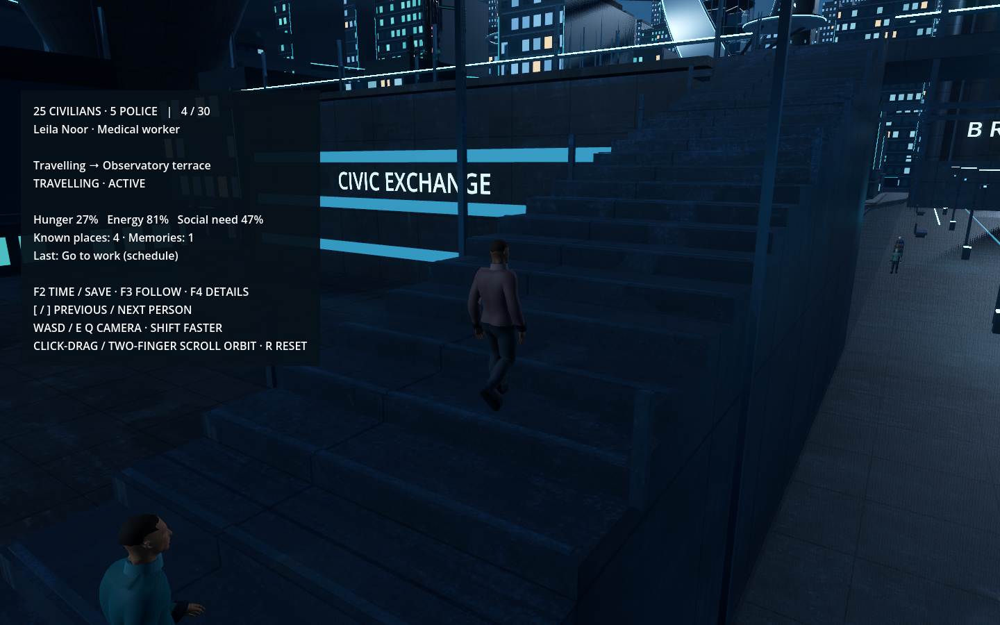

# Stage 3E — Population

Implemented for review on 12 October 2026. This checkpoint expands the existing district to **25 civilians and 5 police**. The city layout, rings, atmosphere and Brother Eye satellite are retained.

## Review

Open `Review Population.command` to start following Alex in the normal saved city. `Launch Brother Eye.command` and `Review Behavior.command` use the same population and save.

- **[ / ]** selects the previous/next resident, including police (26–30).
- **F3** toggles following; **F4** toggles the selected resident's details.
- **WASD / E Q**, Shift, click-drag and two-finger scrolling retain the existing free camera movement and orbit controls. **R** resets the follow view.
- **F2** opens time/save controls. Resume if the previous session was paused.

Residents travel between individual promenade, market, plaza and terrace destinations. Their work starts are staggered. Police use three known district patrol stops during work hours, changing patrol destination every ten simulated minutes. Needs can interrupt work or patrol for recovery. Only confirmed physical arrival starts recovery or the destination activity.

## Implementation

Each person has a durable ID, name, role, appearance, position, heading, needs, schedule, current goal and bounded memories. Civilians know four local places; police additionally know their own three patrol stops. They do not share global knowledge.

Eight civilian palettes vary coat, skin and hair materials. Police use a navy/slate uniform with restrained gold details and a visible POLICE label. All use the supplied human base, sharing 25 mesh resources and the animation resources; material variants are cached. This checkpoint varies materials, not body shape or clothing geometry. The astronaut remains the separate Exceptional Agent asset for Stage 5.

All 30 use one collision-derived navigation map. Local avoidance steers around other people; body collision remains enabled. A pedestrian waiting for another person reports WAITING FOR SPACE without repeatedly rebuilding static navigation. Small supported steps and larger-obstacle detours retain the earlier obstacle fix. Animation cadence follows actual displacement.

Movement is reported as one atomic batch, normally once per second, with earlier reports for navigation changes. Sequence numbers and durable command receipts protect replay. On pause, disconnection or shutdown, movement freezes consistently with the existing lifecycle.

Schema 3 preserves the existing world, clock and every pre-existing Alex field, then adds 29 deterministic identities once. It does not reset needs or routines. The acceptance and visual runs use isolated saves; the normal save upgrades on its next launch.

## Validation

- 22 backend tests: population counts and local knowledge, migration preserving Alex, atomic batch validation and rollback, duplicate-command handling, full restore, existing clock and lifecycle behavior.
- Four real Godot population launches: actual schema-2 upgrade, shared resources, routes to every known destination, travel and crowd clearance, all-person persistence, backend interruption recovery, frontend journal replay, no duplicate bodies, one receipt per replayed batch and SQLite integrity.
- The existing four-launch Stage 3D behavior acceptance and five-launch Stage 2 lifecycle acceptance pass.
- All 14 existing obstacle checks pass, including the previously stuck curb position, small steps, larger detours and safe unreachable-route waiting.
- Native Metal / Forward+ screenshots were inspected at 1440 × 900.

Evidence is in `docs/previews/stage3e/`; checks are reproducible with `tools/check_stage3e.py`, `tools/check_stage3d.py`, `tools/check_stage2.py` and `godot/scripts/check_obstacles.gd`.

## Measured performance and limits

On this Apple M2 Pro, a 12-second native boulevard sample with all 30 residents loaded and active recorded **10.107 ms median frame time** (about 99 FPS equivalent), **11.781 ms p95**, 1,259 sampled frames, 6,181 draw calls and approximately 466 MiB of renderer-reported video memory. The last sampled physics processing time was 2.302 ms. Raw values are in `previews/stage3e/performance.json`.

This is a short sample from the recorded camera view, not a guarantee for every viewpoint or larger populations. Rendering detail levels and larger-population optimization remain Stage 6 work. Police patrol rather than enforce laws in this checkpoint. Work, eating, rest and socializing are still abstract activities at outdoor destinations, without interiors or conversational interactions. Shared rigs retain the prior animation polish limits. Durable event/receipt history still grows with use; archival remains future work.

Stage 4, Brother Eye control, has not been started.
