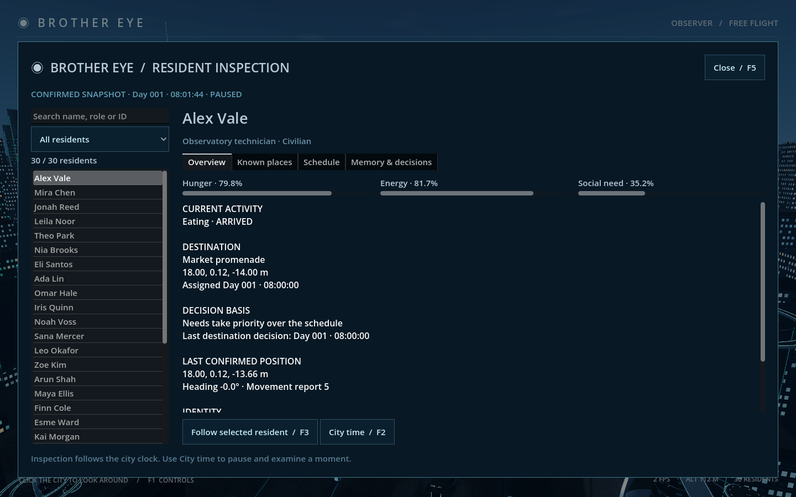
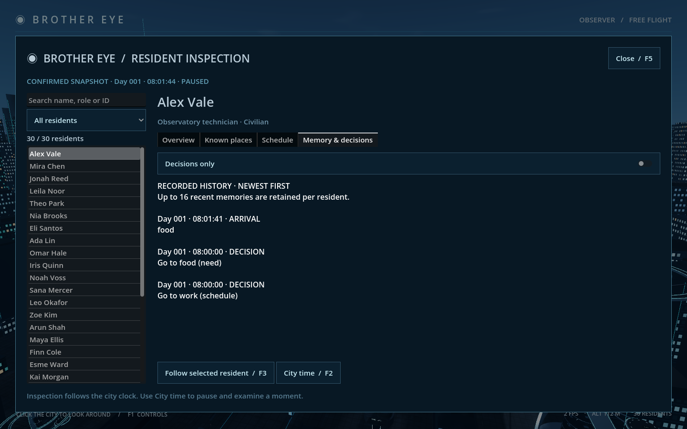
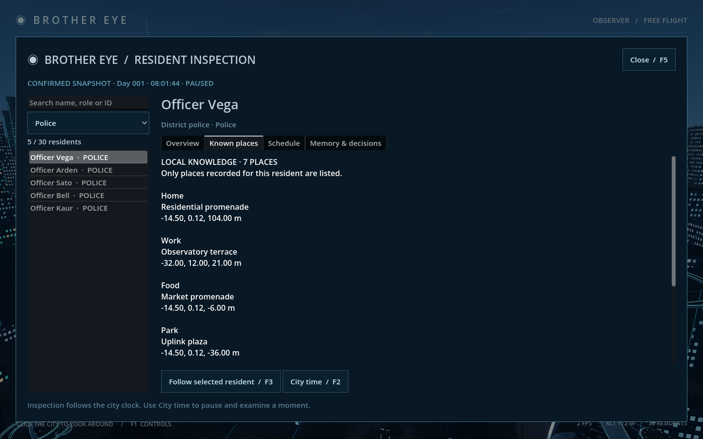

# Stage 4A — Brother Eye inspection

Implemented for review on 12 October 2026. Brother Eye now provides a searchable resident inspector over the live authoritative city snapshot.

## Review

Open `Review Inspection.command` or press **F5** in the normal city. The menu also has an Inspect residents button. This uses the existing city save.

- Search names, roles or IDs; filter all residents, civilians or police.
- Select a person to view their dossier. An empty search keeps the current dossier available.
- **Overview:** needs, current activity, destination, schedule/need basis, assignment time, last decision time, identity and last confirmed position. The local character position/state is shown separately.
- **Known places:** only that person's recorded places, including the additional patrol stops known by police.
- **Schedule:** recorded daily hours and destinations, with an explanation of patrol timing and need interruptions.
- **Memory & decisions:** retained memories in reverse chronological order, with timestamps and a Decisions only filter.
- **F3 / Follow selected resident:** closes the inspector and follows that person with the existing camera controls.
- **F2 / City time:** opens the existing time panel for pausing, speeds and saving.
- **Escape / F5 / Close:** returns to the city view.

## Data and behavior

The inspector reads the confirmed simulation snapshot and refreshes four times per second. It shows the city clock and paused/running status. During connection loss, the retained snapshot is explicitly marked LAST KNOWN and the follow action is disabled. Snapshot time is simulation time, so pausing does not make the record appear newly advanced.

`godot/scripts/inspection_model.gd` defines a version-1 read interface: `roster(world, query, kind)` and `inspect(world, citizen_id)`. Inspection returns world identity, revision, tick, city time, pause status and a deep copy of the resident record. Missing identities return an empty result. Nested data cannot mutate the source world through this interface. There is no additional network endpoint or save migration.

Browsing, filtering and switching pages issue no simulation commands. Selecting a resident updates the existing follow selection. Opening inspection releases the cursor and suspends explorer movement, follow movement and orbit, while the population continues according to city time. Closing restores the previous camera-input context. Live text updates preserve the current page's scroll position.

Decision basis reflects the stored goal reason. The history displays actual retained memories; it does not generate explanations or reconstruct forgotten events. The existing limit of 16 memories per person remains. The inspector supplies the observation foundation for later Brother Eye evaluation; it does not yet contain an AI model, interventions or a council of agents.

## Validation

`tools/check_stage4a.py` uses a disposable world and two actual Godot launches. A hungry resident physically reaches the market to generate a real arrival event; the second launch verifies that identity, needs, knowledge, schedule, goal and history restore.

Checks cover the review launcher, F5 opening, all 30 residents, role search, police filtering, empty searches, unknown identities, detached nested data, every dossier page, decision filtering, stale connection labeling, follow selection, held movement keys, touchpad orbit isolation, Escape, city-time handoff, no inspection commands and unchanged resident/world state during browsing. Native Metal / Forward+ captures at 1440 × 900 were visually reviewed. No acceptance run changes the user's normal save.

The existing four-launch population acceptance passes, including all 30 route completions, movement clearance, persistence, backend recovery and frontend journal replay. All 19 existing follow-camera checks pass. Logs and screenshots are in `docs/previews/stage4a/`.

Run `.venv/bin/python tools/check_stage4a.py` for headless acceptance, or append `--native` for the windowed screenshot review. Normal movement/autosave processing remains active outside inspection; the read-only test isolates periodic explorer autosaves so they cannot be mistaken for inspection writes.

Stage 4B is the next separate checkpoint.
