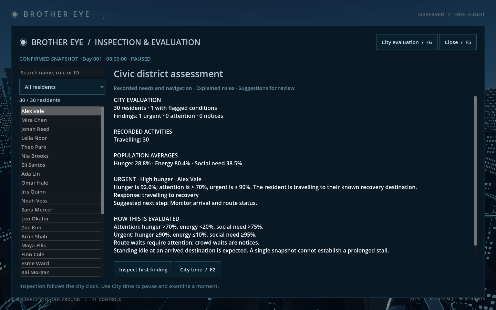
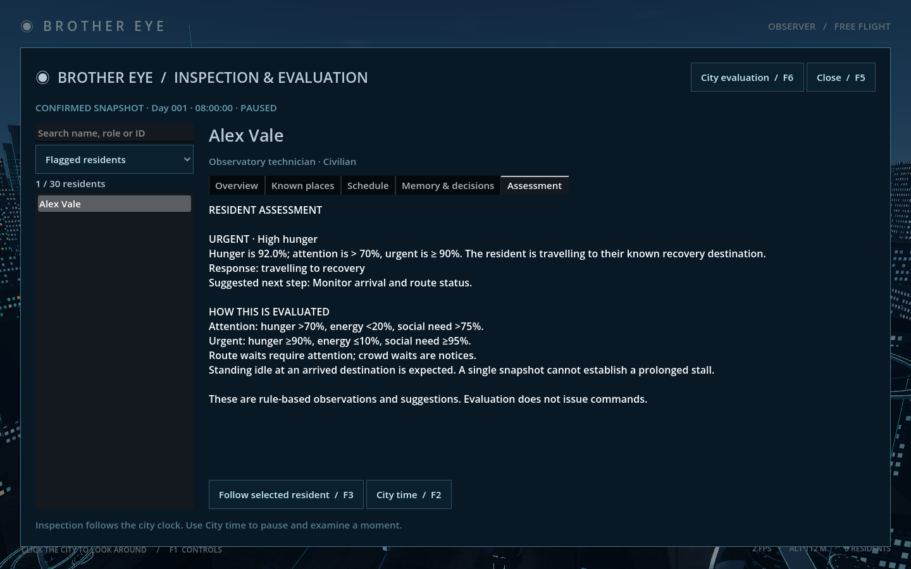
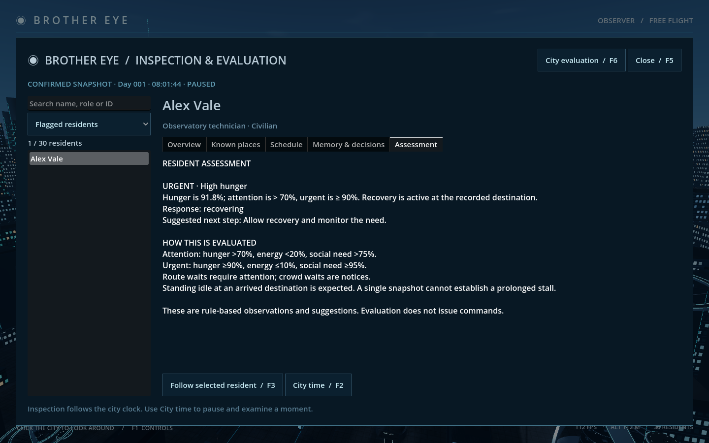

# Stage 4B — Brother Eye evaluation

Implemented for review on 12 October 2026. Brother Eye now evaluates recorded city conditions with explicit, deterministic rules and presents evidence with each finding.

## Review

Open `Review Evaluation.command`, press **F6** in the city, or choose City evaluation in the inspector/menu. This uses the normal city save. Time retains the previous session's pause setting; use **F2 → Resume** when needed.

The city assessment shows population totals, distinct residents with flagged conditions, finding priorities, recorded activities and average needs. **Inspect first finding** opens the highest-priority resident's Assessment tab. You can also select any resident and choose Assessment, or filter the roster to Flagged residents. Existing inspection, search, camera following and time controls remain available.

Each finding includes its priority, observed condition, threshold evidence, current response and suggested next step. Selecting a finding changes the inspected resident; it does not change their goal or issue an intervention.

## Rules and scope

| Recorded condition | Attention | Urgent |
|---|---|---|
| Hunger | Greater than 70% | At least 90% |
| Energy | Less than 20% | At most 10% |
| Social need | Greater than 75% | At least 95% |

The attention boundaries match the current planner's need triggers. Urgent boundaries are project review priorities, not health diagnoses. A finding records whether the current activity is addressing the need, whether the resident is travelling to the corresponding known recovery destination, or whether the need is not currently addressed. Recovery requires confirmed ARRIVED navigation and the corresponding eating/resting/socializing activity. Findings remain visible while the need is high; recommendations recognise ongoing recovery.

WAITING FOR ROUTE is an attention finding describing the reported wait. WAITING FOR SPACE is a notice describing temporary local crowd yielding. The evaluation does not infer wait duration from a single snapshot. Standing idle at an arrived destination is expected, and a TRAVELLING report alone does not prove movement or a prolonged stall.

No flagged conditions means that none of these rules triggered. It is not a claim about unobserved hazards, crimes, relationships, infrastructure or general well-being. Incomplete observations are labelled unavailable/incomplete. Ordinary citizens retain their own local knowledge.

## Reasoning interface

`backend/evaluation.py` provides the pure `evaluate(world)` interface, version 1, engine `deterministic_rules`, ruleset `civic-needs-navigation-v1`. It returns source world identity/revision/tick/clock/pause state, coverage, summary and structured findings. Each finding has a stable resident/rule ID, rule code, priority, evidence, explanation, response and recommendation. Ordering is deterministic by priority, resident identity and rule code.

The service attaches assessments alongside welcome, snapshot and acknowledgement state. The assessment is calculated from that exact outgoing state, including replayed receipt snapshots. It is never added to the durable world or receipt, so evaluation causes no migration or save writes. The client accepts an assessment only with its matching state and verifies its source context before rendering. Offline retained data is labelled LAST KNOWN; a report that does not match the current snapshot is shown as unavailable.

A later reasoning provider could consume verified observations behind a versioned interface. This checkpoint implements explainable rules. Local/hosted language models and councils remain future decisions; none was installed or connected. Interventions remain Stage 4C.

## Validation

- 29 backend tests pass, including seven evaluation tests: exact boundaries/priorities, recovery versus mere travel, route/crowd distinctions, expected idle behavior, pure/deterministic results, incomplete coverage and derived wire data without persistence.
- Actual Godot/service acceptance verifies matching source context, 30-resident totals, a 92% hunger finding with evidence, flagged filtering, priority selection, read-only browsing, unavailable mismatched data and stale/offline labelling.
- A resident physically arrives at the market; the live report changes from travelling to recovery to recovering and recommends monitoring ongoing care.
- Native Metal / Forward+ captures at 1440 × 900 were visually reviewed.
- The two-launch Stage 4A inspection/restore checks and five-launch Stage 2 lifecycle/replay checks pass.

All test worlds are disposable and separate from the normal city save. Reproduce with `.venv/bin/python tools/check_stage4b.py`, adding `--native` for windowed screenshots. Logs and captures are in `docs/previews/stage4b/`.
