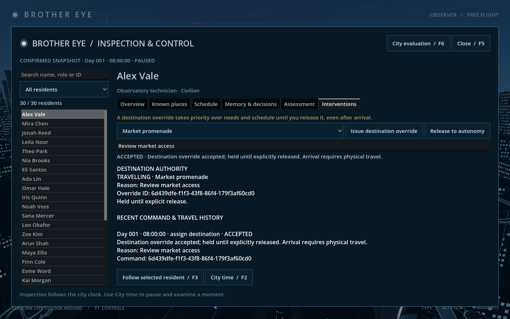
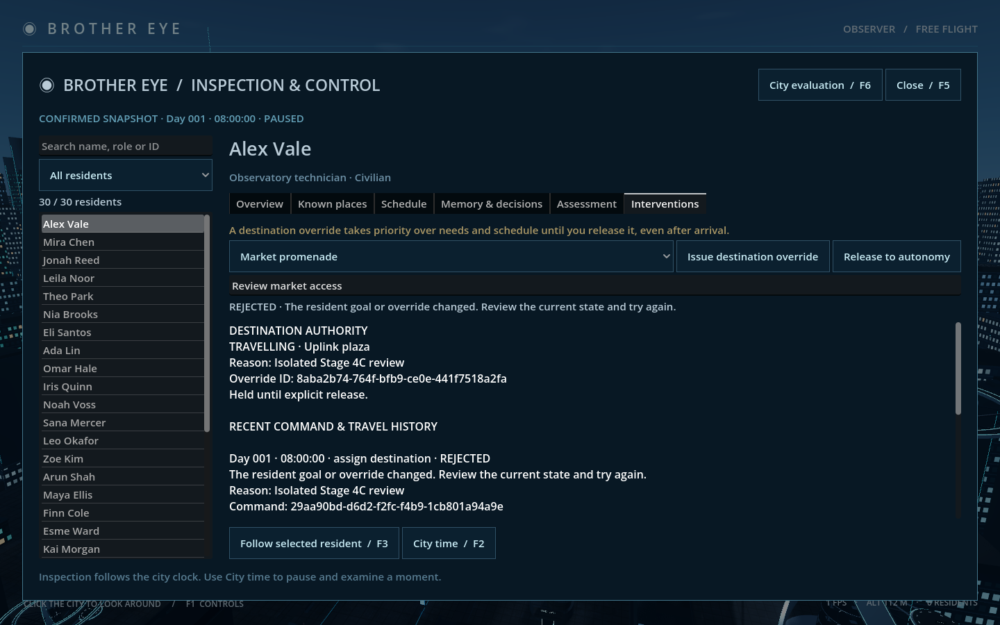
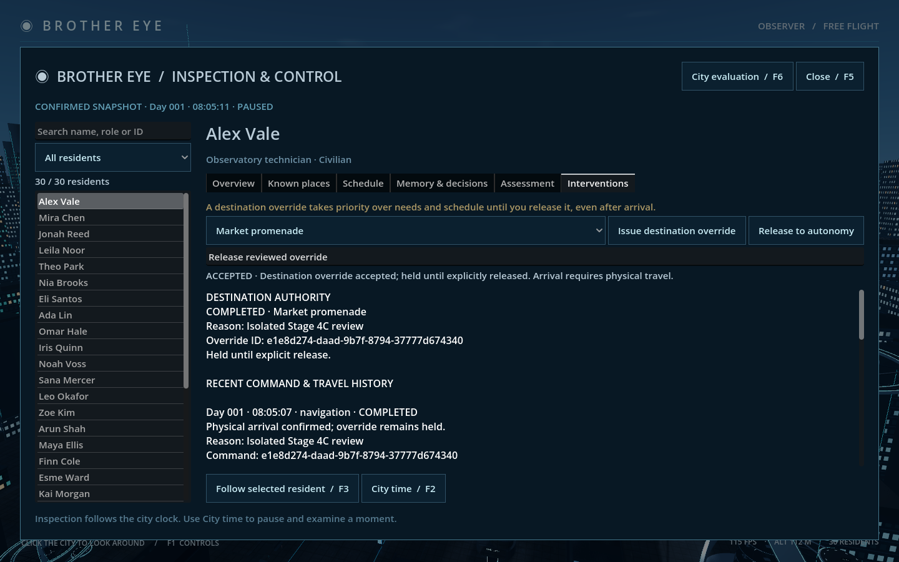

# Stage 4C — Validated destination interventions

Implemented for review on 12 October 2026. Brother Eye can explicitly assign a known destination to any of the 25 civilians or 5 police, replace that override, and release the resident back to autonomous needs and routines. No AI provider, memory editing or Exceptional Agent authority is implemented.

## Review

Open `Review Interventions.command`, or use **F5 → select resident → Interventions**. This launcher uses the normal city save. Choose a destination, enter a reason, and press **Issue destination override**. **Release to autonomy** also requires a reason. **F3** follows the selected person; **F2** opens city time. Paused commands change the goal immediately but movement waits for Resume.

An override takes priority over needs and schedules **until explicitly released**, including after arrival. There is no expiry. Choose destinations carefully: directing someone away from recovery can leave a need unaddressed. Arrival still requires collision-backed physical travel; issuing a command does not teleport, reset needs or grant knowledge of another resident's places. At the destination, the existing eating/resting/working/socializing/patrolling activity begins. A completed override remains held. Releasing it creates a fresh goal chosen by autonomous needs and schedule.

Controls disable when disconnected, when a reason is missing, or while that resident has a pending intervention. Pending, accepted and rejected command results are separate from the active override's travelling, waiting-for-route, waiting-for-space or completed status. The history records replacement and release too. Rejections leave the resident unchanged and do not freeze the service. Browsing or evaluating alone never issues a command.





## Command and authority contract

Wire protocol remains **1**. `intervene` is a one-shot command with a unique UUID, never coalesced with movement updates. Exact payload fields:

```json
{
  "world_id": "current-world-uuid",
  "citizen_id": "resident-uuid",
  "expected_goal_id": "observed-goal-uuid",
  "expected_intervention_id": null,
  "action": "assign_destination",
  "place": "food",
  "reason": "Review market access"
}
```

`expected_intervention_id` must equal the current override's command UUID, or null if autonomous. `release` uses the same fields, `action: "release"`, `place: null` and the existing override ID. A replacement uses `assign_destination` and the current goal/override IDs. Both goal and override must still match. This deliberately checks task context rather than requiring an exact clock tick/revision, which changes during normal live observation and camera saves.

Backend validation permits only existing civilians/police and their own known-place keys. Extra fields, unknown actions/places/targets, stale context, a different world, release without an override, or an empty/nonprintable/>240-character reason reject. Every assignment creates a fresh goal ID, including a repeated destination. A release also creates a fresh autonomous goal. Old movement reports cannot arrive at, complete or overwrite the replacement task. Ordinary knowledge remains local; no immutable ideology can be edited through this API. Stage 5 still requires an explicit ideology/authority decision.

Validly enveloped intervention attempts return an `ack` with `payload.intervention = {id, citizen_id, outcome, message}`, where outcome is accepted or rejected. Rejections receive durable receipts and audit entries, increment revision, but leave resident records unchanged. Malformed envelopes/UUIDs and reuse of an ID for another request retain the existing protocol-error behavior; they are not valid intervention attempts and do not receive a new intervention receipt. Retrying an identical UUID/request returns its original result, even if the resident has since changed.

## Persistence and lifecycle

Schema **4** adds nullable `citizen.intervention` and a global `intervention_history` containing the latest **64** audit entries. Schema 3 migrates without changing identities, needs, positions, clock, goals or previous receipts; schemas 1/2 still migrate through population creation. Active overrides store command ID, destination, reason, issue time and travel status.

`backend/interventions.py` owns validation, authority, lifecycle and audit projection; `citizens.py` holds overridden planning and maps confirmed physical progress to status. `service.py` applies changes to detached state and commits world, audit and receipt atomically. A failed transaction rolls back all of them. Navigation outcomes are committed in the progress transaction. Audit entries include actor, reason, target, command ID, simulated time, outcome, message and before/after goal/override context. Full audit entries remain in SQLite `events.data_json.interventions`; the bounded recent list is for live inspection. Receipts retain the submitted source context and original result. History/receipt archival remains future work.

The bridge journals `intervene`, replays in order and removes it only after acknowledgement. Replayed stale snapshots cannot overwrite newer state. A rejected intervention is an acknowledged business outcome, not a fatal transport error. App/service restarts preserve the override; paused/offline time does not expire it. Route/crowd waits do not complete a task or silently release authority. There is no intervention timeout or automatic fallback; release/replace it explicitly.

## Verified results

All fixtures use disposable databases; the normal `runtime/world.sqlite3` was not opened or altered by these checks.

| Command | Actual result |
|---|---|
| `.venv/bin/python -m unittest discover -s backend/tests -v` | **38 tests OK, 2.806 s**. Includes precedence/release, rejection purity, stale context/reports, waits, same-place replacement, police local places, schema 3 migration, rollback, bounded history/full SQL audit, restart/dedup and actual service kill after durable receipt without consuming ACK. |
| `.venv/bin/python tools/check_stage4c.py` | Four launches, all `STAGE4C_CHECK … failures=0`; UI-issued paused command, replacement/conflict/release, backend SIGKILL recovery, actual body travel >2 m before eating/completion, app restoration/no offline time, frontend exit with unsent durable journal and replay. One receipt and accepted audit event for replay; one world/schema 4/SQLite integrity; owned services stop. |
| `.venv/bin/python tools/check_stage4c.py --native` | Same four-launch acceptance plus native Metal/Forward+ captures at 1440×900, visually reviewed for controls/status/history. |
| `.venv/bin/python tools/check_stage4b.py` | `STAGE4B_CHECK failures=0`; source-bound evaluation, real arrival/recovery and read-only behavior retained. |
| `.venv/bin/python tools/check_stage4a.py` | Two launches, write/read failures=0; identities, inspection, filters, follow/modal input and restoration retained. |
| `.venv/bin/python tools/check_stage2.py` | Five phases all failures=0; save/reconnect/backend crash/journal recovery/one world/SQLite integrity retained. |
| `godot --headless --path godot --fixed-fps 60 --script res://scripts/check_obstacles.gd -- --no-simulation` | 14 checks, `OBSTACLE_QA failures=0`; low steps, headroom/footing rejection, large detours and unreachable-route waiting retained. |

Saved evidence: `docs/previews/stage4c/`. Initial verification exposed implementation/test-harness issues which were corrected before these passing runs. Sandbox-denied loopback/Godot log access required rerunning checks with approved permissions; those failed starts are not product acceptance results. Blocked override status is covered by backend progress tests; physical unreachable routing is covered separately by obstacle regression, not by a newly blocked live override scenario.

Stage **4D remains unstarted**: satellite/tower effects, simulated camera feeds and expanded history presentation are separate. Memory/motivation/world-condition interventions, automatic commands, Exceptional Agents and scaling are not included in this checkpoint.
