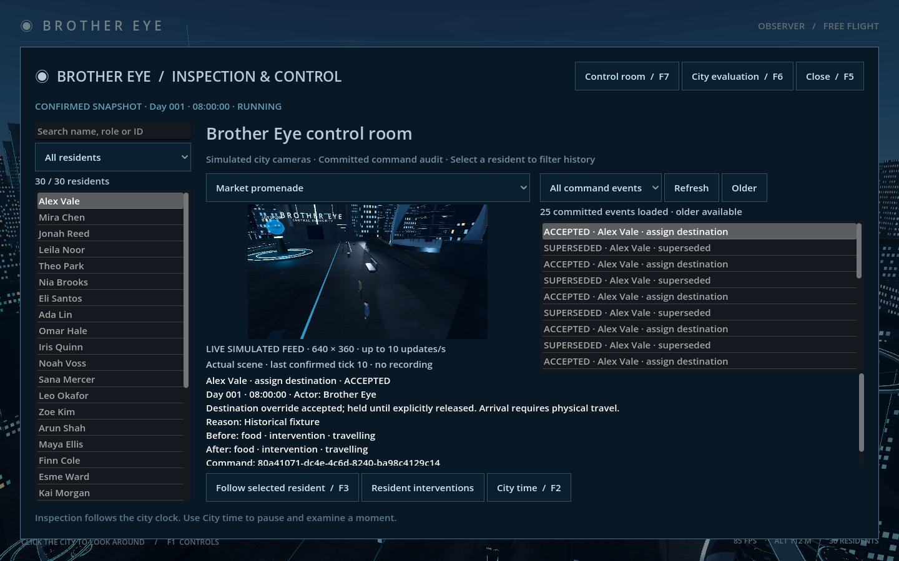
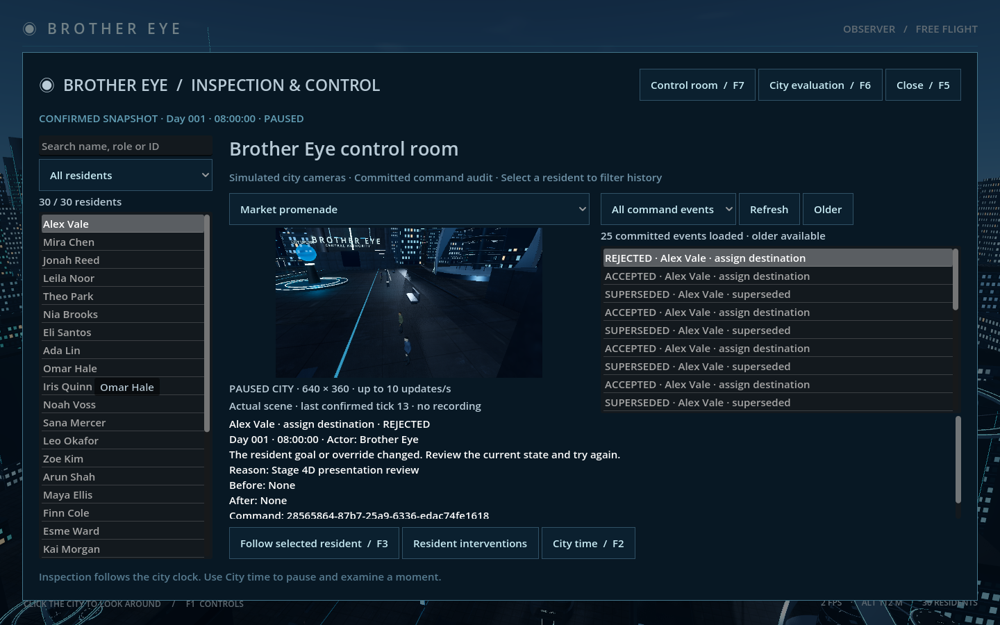
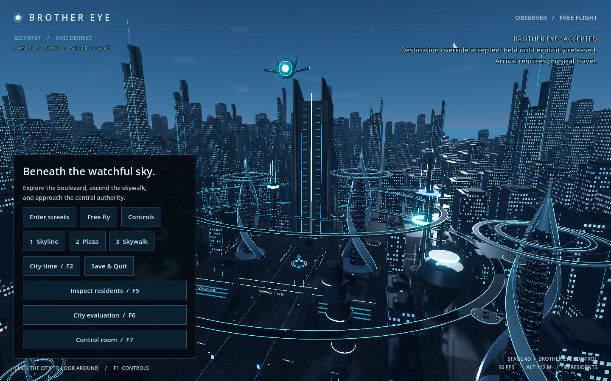

# Stage 4D — Brother Eye presentation and verification

Implemented for review on 12 October 2026. The control room adds real-scene simulated cameras and full committed intervention-history browsing. Restrained lens/tower feedback follows acknowledged commands. Stage 4C authority, city layout, sky, satellite placement and physical navigation remain unchanged.

## Review

Open `Review Control Room.command`, press **F7**, or choose **Control room** from the menu/inspector. This uses the normal city save and its existing pause setting. **F2** opens time controls; **F3** follows the selected resident; **Resident interventions** opens their existing destination controls; **F6** returns to evaluation; **Escape/F5** closes inspection.

Choose one of four fixed simulated cameras: promenade north, market, uplink plaza or the authority tower's district view. Street views use positions at the existing lamp camera hardware. They render the **same World3D, geometry and physical residents** as exploration, through a single 640×360 SubViewport updating at most ten times/second. No cloned city, prerecorded video or extra background simulation exists. Camera selection does not move or replace the main exploration/follow camera or alter its saved view.

Running feeds say LIVE SIMULATED FEED; paused feeds say PAUSED CITY. The displayed tick is the last confirmed backend snapshot context, not a claim that every local rendering/physics frame exactly matches that tick. Disconnecting freezes the last image and labels it LAST FRAME; switching cameras disables offline. Closing the control room or switching to another inspector mode disables feed rendering. Paused city simulation still permits cosmetic sky/landmark rendering. There is no recording, rewind, PTZ or multi-feed wall.

The history list shows **committed** accepted, rejected, superseded, released, travelling, waiting and completed audit events. Select an entry for actor, simulated time, reason, message, before/after goal/override summary, command UUID and audit identity. Select a resident and use **Selected resident**, or browse **All command events**. **Refresh** retrieves newest records; **Older** appends another page. New events are indicated without repeatedly resetting your selection. Offline retained history is labelled LAST KNOWN. Pending commands remain interface status; they are not inserted into committed history.




## Command feedback and replay rules

A pending intervention has amber interface status. A newly accepted, matching, current acknowledgement with an actual committed accepted audit entry produces one brief cyan emission pulse on the existing satellite lens and command-tower axis. Materials are duplicated locally so other city cyan lights are unaffected. The tower axis retains its original position/size, using an individual mesh instead of its former decorative batch entry; collision shapes and navigation layout do not change.

The pulse decays over 1.4 seconds of presentation time. It represents **command acceptance**, not physical arrival or successful completion. Arrival/wait/completion remain authoritative status and audit records, as in 4C. Rejection shows an amber explanation and cancels any remaining pulse, without starting another. No beam, geometry motion or satellite relocation is added.

Fresh feedback requires correlation with the bridge's pending intervention UUID, accepted current state and a committed audit entry. Welcome history establishes a silent baseline on startup/reconnect. Duplicate or stale receipt acknowledgements cannot start another pulse or replace newer world state. Replayed results are explicitly labelled **RECORDED RESULT** in both the banner and intervention controls. Offline presentation cancels the pulse; reopening/reconnecting does not celebrate old actions. A genuinely unsent pending command that first applies after recovery can still receive its first acceptance feedback.




## Read-only history API and architecture

No schema migration is needed: schema remains **4**, protocol **1**. `query_interventions` is an authenticated, transient read request, outside the durable command queue/journal. Exact payload:

```json
{"citizen_id":"","before_seq":0,"before_index":0,"limit":25}
```

Empty citizen ID means all targets. Cursor zero starts at newest; subsequent pages use the response's `next_cursor`. `limit` is 1–50; the UI uses 25. Exact integral JSON floats are accepted for Godot replay-compatible numeric representation; bools/fractions/nonfinite/out-of-range values and extra fields reject. Queries create **no world revision, event or receipt**, and do not advance time or issue actions.

The `intervention_history` response contains world ID, observed revision, requested target, entries, `has_more` and `next_cursor`. Entries add SQLite event sequence/index to the original committed audit data. Paging orders by descending event sequence and intra-event index, so multiple outcomes in one transaction paginate without duplicates and newer inserts do not shift older cursors. It reads full SQLite audit records, including entries no longer in the world's 64-event recent cache. It is not a general event-log/receipt debugger.

The bridge correlates transient query IDs; recoverable query errors go to the panel rather than freezing durable commands. The panel validates world/target/query identity, indicates loading/errors/timeouts and permits Refresh to retry. History loads after service restoration even if opened before connection. Ordinary citizens gain no new knowledge from Brother Eye's global views.

Important files:

- `backend/history.py`, `backend/tests/test_history.py`: read-only SQL projection and cursor/validation/purity tests; `backend/service.py` dispatches it before durable command processing.
- `godot/scripts/control_room.gd`: one viewport, four fixed camera transforms, throttled rendering/status, filters, paging and event details.
- `command_feedback.gd`: acknowledged-command presentation, silent baselines and UUID dedup; `city.gd` exposes the existing lens/axis meshes.
- `simulation_bridge.gd`: session/ACK/query signals and transient queries; persistent UUID queue/replay semantics are unchanged.
- `inspection_panel.gd`, `interface.gd`, `intervention_controls.gd`: F7/menu/modal integration, recorded-result labels and existing inspection/evaluation transitions.

## Verified acceptance and limits

All test databases are disposable. The normal `runtime/world.sqlite3` was not opened or edited by acceptance/capture runs. Source assets and licensing are unchanged.

| Command | Actual result |
|---|---|
| `.venv/bin/python -m unittest discover -s backend/tests -v` | **41 tests OK, 3.196 s**, including full-history pagination across 139 fixture events, intra-transaction cursor boundaries, target filters, concurrent newer inserts, invalid requests and read-only state/event/receipt checks. Existing authority, rollback, migration and real service crash/replay tests pass. |
| `.venv/bin/python tools/check_stage4d.py` | Two launches, write/read failures=0; real shared scene/independent camera, older history beyond 64 entries, offline freeze, modal rendering suspension, live physical movement, filtering, evaluation transition, acknowledgement-only feedback, conflict rejection, receipt replay, backend reconnect and app restoration. |
| `.venv/bin/python tools/check_stage4d.py --native` | Two launches, failures=0; actual rendered feed detail, pending/rejected/recorded-result feedback, recoverable history-query errors/retry, camera/history visual review and measured render budget. Native Metal / Forward+ at 1440×900. |
| `.venv/bin/python tools/check_stage4c.py` | Four launches, all failures=0; physical travel/eating/completion, held/released authority, conflicts, backend interruption and frontend pending-journal replay remain correct. |
| `.venv/bin/python tools/check_stage4a.py` | Two launches, write/read failures=0; inspection, read-only selection, follow/modal/touchpad controls, identities and restore retained. |
| `.venv/bin/python tools/check_stage2.py` | Five phases all failures=0; save, reconnect, crash/journal recovery, one world, SQLite integrity and service shutdown retained. |

Saved logs, captures and performance data are in `docs/previews/stage4d/`. Initial verification found and fixed startup history loading, offline-label clearing and test-harness issues before passing acceptance. Sandbox-denied loopback/Godot logging required approved reruns. Existing navigation still reports 2,185 polygons and 657 collision shapes. The 4C physical-travel regression ran against this geometry; obstacle/stride assets/controllers were not modified or rebuilt.

Performance is a short controlled pair, not a scaling guarantee; exact results are recorded below from `performance.json`. One selected feed adds periodic rendering work. Full SQL audit/receipt history still grows without archival, and history reads are not yet benchmarked on very large saves. Only requested older pages are loaded. Fixed-camera visibility depends on actual buildings/occlusion; no through-wall surveillance or per-resident camera tracking is claimed. No new AI provider, authority beyond destination commands, Exceptional Agents or population scaling is implemented.

Stage 4D is the presentation checkpoint. The proposed 4E combined acceptance remains separate; Stage 5 requires the unresolved ideology/authority decision before implementation.

Native sample: **8.294 ms median / 9.241 ms p95 closed**, **8.634 / 11.663 ms open**; feed **9.482 updates/s open, 0 closed**, 4 seconds each. The native sample ran after the other acceptance instances finished. Draw-call snapshots (5007 closed / 5061 open) reflect whichever frame was sampled and do not count all intermittent feed frames.
