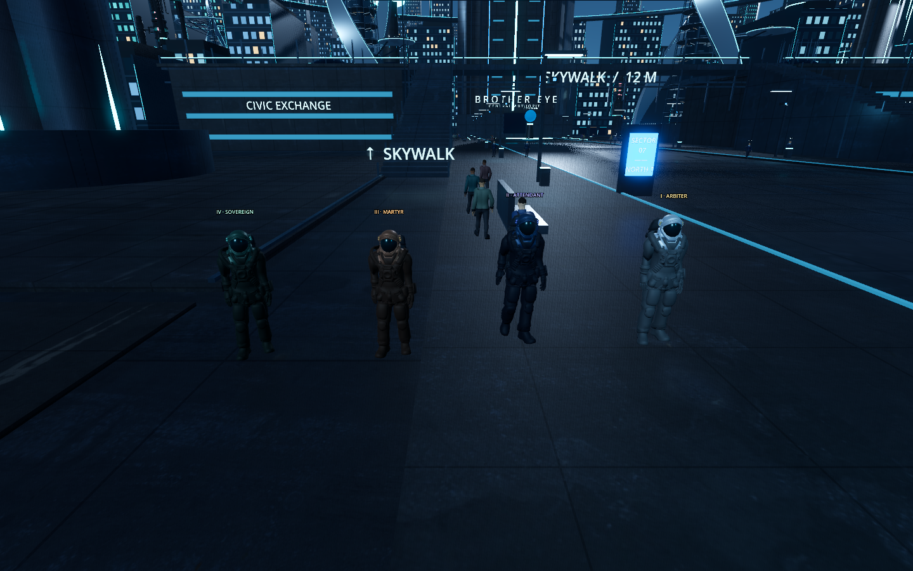
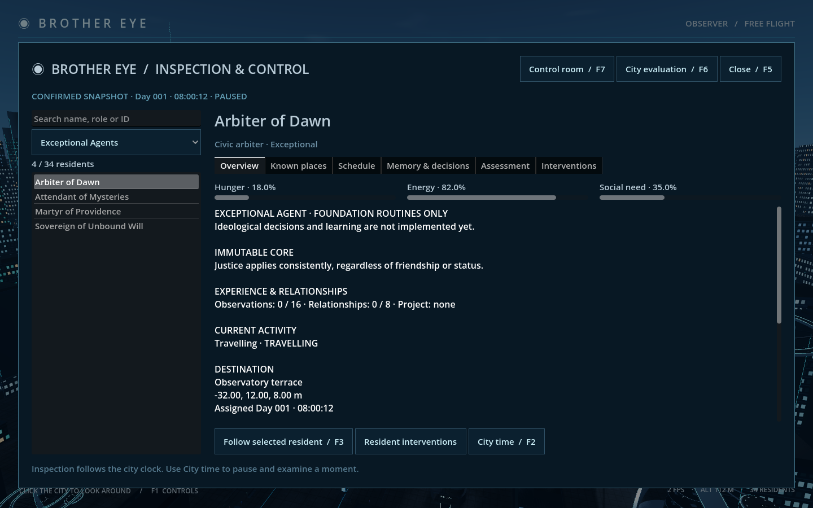

# Stage 5B — Exceptional Agent foundation

Implemented and verified 12 October 2026. **34 persistent people: the original 25 civilians and 5 police, plus four Exceptional Agents.** The new agents use the existing astronaut rig/clips and distinct cached material palettes with named Roman-number labels. Their ideological cores are validated immutable data. Autonomous behavior remains explicitly labelled **foundation routines**; ideological choices, local sensing, assistance, learning and projects are not implemented yet. Those belong to 5C/5D.

## Review

Open `Review Exceptional Agents.command` to launch the normal city with the Exceptional Agents filter selected. Alternatively use F5 and choose **Exceptional Agents**. Select a name to inspect its core, experience/relationship placeholders, known destinations and routine. F3 follows it with the existing unlocked WASD/EQ and touchpad orbit controls. Interventions supports destination assignment/replacement/release with the same required reason and context checks as ordinary residents. F2 controls time; physical movement stops while paused.

The four appearances are silver/gold Arbiter, blue/violet Attendant, bronze/amber Martyr and green/teal Sovereign. Materials, five astronaut mesh resources and six existing animation clips are shared; no source model, animation, attribution or license was replaced. Existing character corrections and the excluded noncommercial supplied run remain unchanged. Names and Roman-number labels complement color differences.

## Persistence and authority

- **Save schema 5, protocol 1.** `backend/exceptional.py` holds the four canonical profile keys, names/roles, core text and version 1. Stable UUID5 identities derive from world ID + profile key.
- Existing schema-4 saves append four once, with the original 30 resident records unchanged, including active overrides, goal/memory/need/position/knowledge fields. World identity, clock and explorer state remain. Migration increments revision once; state, schema and migration event commit atomically. A failed migration rolls back all three.
- Cached historical request/response receipts are preserved byte-for-byte. They can contain old 30-person snapshots; the new revision makes them stale under the existing client guard. Replaying the old receipt drains the pending journal without replacing the 34-person world or emitting a fresh historical pulse. Existing 30-person movement batches remain valid; new batches support up to 34.
- New saves start at 34. Earlier schema migrations still produce the original ordinary population first, then append the four. Reopening schema 5 adds no people or migration event. Normal launch/review opens the real save and performs this migration; acceptance tests never open it.
- Per-agent `exceptional` fields: profile, profile_version, core, behavior_stage (`foundation`), observations (empty), relationships (bounded to 8) and project (null). Identity/profile/core/appearance must match the canonical catalogue. Observations/projects are deliberately rejected as nonempty in this checkpoint; future producer/validator/migration work must be explicit.
- Sovereign has one directed seeded companion bond to existing Mira Chen (trust 25). Mira's record is unchanged; no reciprocal knowledge/bond is invented. The other three begin with no relationships. Trust does not adapt yet. Fixed companion membership and bounded values are validated.
- Brother Eye can direct the new `exceptional` kind only to its own known places. Destination commands cannot edit core, memories, relationship or project fields. Held overrides outrank foundation needs/routines; blocked travel waits and completed remains held until released. Release creates a fresh routine goal; no ideological agreement or learning is claimed.

The foundation uses the existing needs/schedule planner, including its current thresholds. Stage 5A's future ideological priorities and interaction rules are **not** active merely because core text is stored.

## Integration and files

`backend/citizens.py` separates original population size 30 from current size 34, validates 25/5/4, and preserves ordinary expansion behavior. `store.py` migrates to schema 5 and validates exceptional identity/state. `service.py` accepts 1–34 movement reports; `interventions.py` permits the new kind without widening action scope.

`pedestrian.gd` supports a model path and body height. Exceptional actors reserve 2 m collision/avoidance height for their 1.95 m model; the single shared navigation map reserves 2 m headroom. Civilian torso/flat-foot geometry and 25 cm step limit stay the same. `persistent_population.gd` instantiates the correct model before adding each new actor; `exceptional_appearance.gd` applies cached palettes/labels. No clone world or separate agent process is introduced.

Inspector adds an Exceptional Agents filter while retaining civilian/police/flagged indices, full-name roster/tooltips, immutable core and explicit foundation limitations. Its read-only projection includes a display-name lookup for directed relationships; that display lookup is not agent planning knowledge. Evaluation naturally includes all 34 people under the existing source-bound rules. Existing control-room/audit/ACK behavior is preserved.

## Fresh validation

Commands run from project root on disposable databases. All final runs exited 0; evidence is under `docs/previews/stage5b/`.

| Command | Actual result | Evidence |
|---|---|---|
| `.venv/bin/python -m unittest discover -s backend/tests -v` | **46 tests OK, 3.327 s**; five new foundation tests plus existing backend checks | `backend.log` |
| `.venv/bin/python tools/check_stage5b.py` | two phases, failures=0; schema-4 pending receipt replay, original records preserved, 34 bodies/one navmap, 16 reachable destinations, astronaut clips/palettes/core inspection, overrides/physical arrivals/release/backend recovery/app restore | `check.log` |
| Same with `--native` | two phases, failures=0; native Metal Forward+ 1440×900; both screenshots visually reviewed | `native.log`, PNGs above |
| `.venv/bin/python tools/check_stage3e.py` | four-phase population/migration/journal acceptance; **34 moved / 34 arrived**, minimum sampled final-position gap **1.142 m**; travel-clearance assertion passes too | `population.log` |
| `.venv/bin/python tools/check_stage4a.py` | two-phase read-only inspection/filter/follow/modal/touchpad/restore regression passes | `inspection.log` |
| `.venv/bin/python tools/check_stage4e.py` | two-phase observe/evaluate/intervene/block/clear/arrive/recover/audit/backend-restart/app-restore regression passes with 34 people | `control.log`, `control-trace.json` |
| `godot --headless --path godot --fixed-fps 60 --script res://scripts/check_obstacles.gd -- --no-simulation` | **14 checks**, failures=0: stepping, ceiling/footing rejection, large detour and unreachable wait | `obstacles.log` |
| `godot --headless --path godot --editor --quit` | clean final import | `import.log` |

New backend tests cover catalogue/bond identity, migration preservation/idempotence and old receipt compatibility, migration rollback, invalid core/state/identity rejection, and destination override/release invariants for all four. Earlier population/schema tests now assert 34/schema 5, preserve explicit old 30-person fixtures and verify the migration revision increment. Historical milestone logs retain their old counts; executable harnesses target the current runtime. The Stage 4E headless trace was regenerated during this regression; its milestone document records that provenance. Future runs can isolate trace output with `--evidence-dir docs/previews/stage5b`.

No new performance benchmark, assistance/coordination behavior or ideological planning is claimed. No Blender rebuild, AI service or real-save experiment was used. Full Stage 5 combined acceptance and a measured 34-person native sample remain in 5E.

## Immediate next step: 5C

Read `docs/STAGE_5A.md`. Build one complete Arbiter path and shared local observation/request/interaction/planner infrastructure before expanding to the other three. Keep the existing foundation data migration compatible: observations/projects are currently empty and `behavior_stage` is validated as foundation; explicitly revise validation and migrate any new durable fields. Preserve canonical profiles, original 30 identities, receipt/journal compatibility, local evidence and physical at-most-once effects. Stage 5D implements the other policies and voluntary coordination; 5E closes combined acceptance. `PROGRESS.md` carries the remaining Stage 6 plan.
